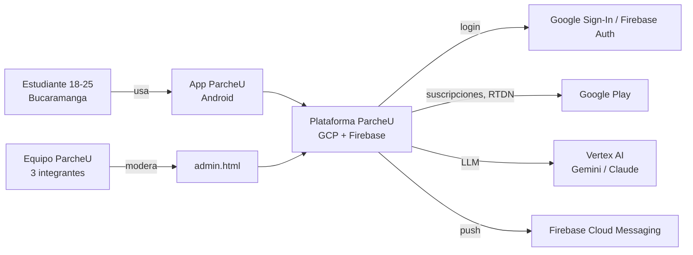
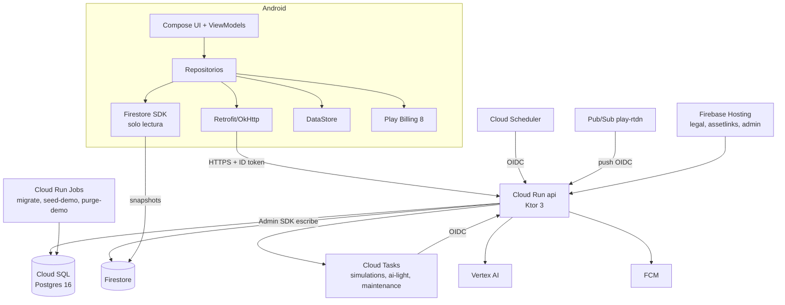

# ParcheU · Arquitectura técnica

> Detalle técnico del plan definitivo ([PLAN.md](PLAN.md)). Cada decisión importante tiene su ADR en [adr/](adr/). Las features que implementan cada parte están en [backlog.md](backlog.md).
> Convención de versiones: lo que está marcado "(verificar)" debe confirmarse contra Maven Central / Google Maven el día que la feature lo agrega; si hay una versión estable más nueva y compatible, se usa esa y se actualiza esta tabla.

## Índice
1. Vista general (C4)
2. Android
3. Backend
4. Modelo de datos
5. Contrato de API
6. Grafo, amigos de amigos, comunidades y evolución
7. Conocer: gemelo, simulación, fila y escenario
8. Tiempo real
9. Billing (ParcheU+)
10. Seguridad y privacidad
11. Observabilidad
12. Entornos e infraestructura
13. Versiones de librerías

---

## 1. Vista general (C4)

Los diagramas completos (contexto, contenedores de prod y de dev en el homeserver, componentes y flujo de una simulación) viven en [c4.md](c4.md); aquí quedan los de contexto y contenedores como referencia.

### 1.1 Contexto



### 1.2 Contenedores



---

## 2. Android

### 2.1 Punto de partida y cambios al proyecto existente

El proyecto `android/` se conserva: namespace y applicationId `me.santiagoreina.parcheu`, minSdk 24, compileSdk/targetSdk 37, AGP 9.4.1 con Kotlin integrado (sin plugin `kotlin-android`), plugin de Compose 2.2.10, Compose BOM 2026.02.01, Gradle 9.6, configuration cache activada. Cambios de E0.7:

| Archivo | Cambio |
|---|---|
| `app/build.gradle.kts` | Java 17 (`sourceCompatibility`/`targetCompatibility` y toolchain), flavors `dev`/`prod`, `buildConfig = true` con `API_URL`, `optimization { enable = true }` en release + reglas de R8, `testOptions.unitTests.isIncludeAndroidResources = true` |
| `settings.gradle.kts` | `include(":designsystem")`, `includeBuild("../contract")` |
| `gradle/libs.versions.toml` | Todas las dependencias previstas del plan (sección 13) |
| `ui/theme/*` | Se reemplaza por el tema de `:designsystem`; `dynamicColor = false` |
| `MainActivity` | `installSplashScreen()`, `enableEdgeToEdge()`, `ParcheUApp()` |
| `res/values/themes.xml` | Tema base `Theme.SplashScreen` con fondo #14111F |

### 2.2 Módulos Gradle

| Módulo | Contenido | Depende de |
|---|---|---|
| `:app` | Navegación, DI, features, datos, push, billing | `:designsystem`, `contract` |
| `:designsystem` | Tokens, tipografía, componentes base y compuestos, mascota, `RadialLayout` y `PuGraph` | Compose |
| `contract` (build incluido) | DTOs y enums compartidos con el backend | kotlinx.serialization |

Se descartó el multimódulo grande (ADR-0005/0006): el aislamiento entre agentes se logra con el esqueleto declarado y la regla "cada feature solo toca sus archivos".

### 2.3 Capas y patrón

- **UI:** Composables sin estado (`XScreen(state, onAction)`) y un `XRoute` que conecta con el ViewModel. Previews con datos falsos.
- **ViewModel:** expone `StateFlow<XUiState>`; acciones como funciones públicas; efectos de una sola vez (navegación, snackbars) por `Channel<XEffect>` recibido con `LaunchedEffect`.
- **Estado:** `sealed interface XUiState { Loading; Loaded(...); Empty; Error(AppError) }` cuando aplica.
- **Datos:** `XRepository` (interfaz) + `XRepositoryImpl` (Retrofit, Firestore, DataStore) + `FakeXRepository` (en `src/test` y `src/debug` para previews y flavor sin backend).
- **Errores:** `ApiError` del contrato → `AppError` (`Network`, `Unauthorized`, `PlusRequired`, `QuotaExceeded(kind, resetsAt)`, `AgeRequired`, `Underage`, `Blocked`, `Suspended`, `ScenarioEnded`, `AiBudget`, `Validation(msg)`, `NotFound`, `Unknown`). Un `ErrorRouter` global abre G1 ante `PlusRequired` y la G2 correspondiente ante `QuotaExceeded`.
- **DI:** Koin 4.1 (`koin-androidx-compose`). Un `XModule.kt` por feature; `AppModules.kt` los lista todos desde E0.7.

### 2.4 Navegación

Navigation Compose 2.9 con rutas `@Serializable` en `navigation/Routes.kt`; `AppNavHost.kt` declara todas en E0.7 con `composable<R> { XRoute(...) }` y cada feature reemplaza su `XRoute.kt`. NavBar visible solo en las raíces (Inicio, Parche, Conocer, Chats, Perfil); nunca en pantallas con botón atrás.

| Ruta | Pantallas | Argumentos |
|---|---|---|
| `Splash` | A1 | - |
| `Onboarding` | A2-A4 | `page: Int = 0` |
| `BasicProfile` | B0 'Tu perfil' (nueva, E2.6) | `edit: Boolean = false` |
| `Underage` | bloqueo por edad (nueva, E2.6) | - |
| `TwinQuestions` | B1 | - |
| `Modes` | B2 (+ diálogo B3) | `fromSettings: Boolean = false` |
| `Consent` | B4 | - |
| `TwinReady` | B5 | - |
| `Home` | C1, I1 | - |
| `Notifications` | C2 | - |
| `Profile` | C3 | - |
| `TrainTwin` | C4 | - |
| `AddFriends` | C5 | `code: String? = null` |
| `Parche` | D1-D5, D2 (sheet), I2 | `community: String? = null`, `month: String? = null` |
| `FriendsOfFriends` | D6, D7 | - |
| `Communities` | D8 | - |
| `Evolution` | D9 | - |
| `Introduce` | E1 | - |
| `IntroResult` | E2 | `id: String` |
| `IntroProposal` | E3 | `id: String` |
| `MatchQueue` | F1 | `mode: Mode? = null` |
| `MatchFound` | F2 | `matchId: String` |
| `ScenarioChat` | F3 | `chatId: String` |
| `Simulation` | F4, F5 | `id: String` |
| `Simulations` | F6, 'Ver todas' | - |
| `Results` | F7, F8, I3, 'esperando' | `simulationId: String` |
| `ChatList` | lista de chats (nueva) | - |
| `Chat` | F9 | `chatId: String` |
| `Paywall` | G1, I4 | `source: String` |
| `PurchaseSuccess` | G3 | `plan: String` |
| `ManageSubscription` | G4 | - |
| `Report` | H2 y la confirmación de reporte enviado (H1 es una hoja `SafetySheetHost` que abre la pantalla de origen, E8.1) | `userId: String` (uuid o `anonId`), `chatId: String? = null`, `name: String? = null`, `anonymous: Boolean = false`, `simulationId: String? = null`, `turnIndex: Int? = null` (E8.7: con `simulationId`, H2 reporta contenido de la IA y `userId` va vacío) |
| `PrivacySettings` | H3 | - |
| `DeleteAccount` | confirmación de borrado (nueva) | - |
| `ExportData` | descargar mis datos (nueva, E8.3) | - |
| `BlockedUsers` | personas bloqueadas (nueva, E8.7) | - |

G2 (límite) es un bottom sheet global controlado por el `ErrorRouter`. Deep links: `parcheu://` para notificaciones y App Links `https://<hosting>/i/{codigo}` → `AddFriends(code)`.

### 2.5 Red, sesión y persistencia

- Retrofit 3 + OkHttp 5 + converter de kotlinx.serialization (`ignoreUnknownKeys = true`, `explicitNulls = false`).
- `AuthInterceptor` agrega `Authorization: Bearer <ID token>` (`FirebaseAuth.currentUser.getIdToken(false)`); `TokenAuthenticator` fuerza refresco ante 401 una vez.
- Login: Credential Manager (`androidx.credentials`) + `googleid` (`GetGoogleIdOption` con el client id web de Firebase) → `GoogleAuthProvider.getCredential` → `signInWithCredential` → `POST /v1/session`.
- DataStore (Preferences): sesión, último grafo serializado (pintado instantáneo de D1), progreso de B1, preferencias de tema.
- **Cerrar sesión** (E8.2): `DELETE /v1/me/fcm-token` → `FirebaseAuth.signOut()` → `CredentialManager.clearCredentialState()` → borrar DataStore de sesión, grafo y B1 (se conserva el tema) → `FirebaseFirestore.terminate()` + `clearPersistence()` → A4 sin historial.
- Onboarding: `SessionDto.onboarding` decide el destino: `NEEDS_TERMS` (hoja de aceptación en A4), `NEEDS_PROFILE` (B0), `NEEDS_TWIN` (B1), `NEEDS_MODES` (B2), `DONE` (C1). `NEEDS_PROFILE` dura hasta que haya fecha verificada y universidad (E2.6); una cuenta de menor recibe 403 `UNDERAGE` en `POST /v1/session` y la app abre `Underage`.
- Firestore: caché offline del SDK para chats; listeners en `simulations/{id}` y `matchTickets/{uid}`.
- Imágenes: Coil 3 (foto de Google).
- QR: ZXing core para generar; Google Code Scanner (`play-services-code-scanner`) para leer, sin permiso de cámara.
- Iconos: Material Symbols Rounded como vector drawables. Fuentes Sora e Inter en `res/font`.

### 2.6 Grafo G0

1. `RadialLayout.compute(nodes, size, fof)` (función pura en `:designsystem`): anillo por afinidad (≥85, 70-84, <70); radios 62/102/140·k (con fof 48/80/108 y capa fof en 140), k = size/328; ángulo estable ordenando por modo y luego por id; relajación para separación mínima; `hitTest(x, y)`.
2. `PuGraph` en `Canvas`: anillos dashed `2 5`; aristas: CONNECTED sólida 2.5 (.95), SIMULATED dash `5 5` (.95), PENDING 1.5 (.3); color por modo; nodo con `affinityAlpha`; halo de selección (tx 2px a r+6); atenuación por filtro (línea .1, nodo .22); fof r 13, fondo s2, borde prt 1.5 (dash `3 3` si anónimo), línea prt dash `2 4`; miniatura si size < 200.
3. Accesibilidad: lista semántica paralela, un nodo por elemento ("Laura P., 87 % afín, Estudio, conectados").
4. Se descartó el layout por fuerzas (no determinista, difícil de probar, no corresponde al diseño). ADR-0007.

### 2.7 Pruebas Android

- JUnit4 + Robolectric (`@Config(sdk = [35])`: Robolectric puede ir detrás de SDK 37) + Compose UI test en JVM, Turbine, kotlinx-coroutines-test.
- **Roborazzi**: capturas de componentes y pantallas en ambos temas; se graban en la rama de la feature y `android-ci` las verifica contra la captura anterior (regresión, `changeThreshold = 0.01`). La comparación con los mockups **no** es automática: I2 la hace lado a lado con los PNG exportados de Claude Design (`docs/mockups/png/`, `scripts/lado-a-lado.sh`) y una checklist (tokens exactos, espaciados ±4dp, tipografía, jerarquía). Estrategia completa en ADR-0022.
- Sin emulador en CI. Lint de Android y ktlint (Spotless) en cada PR.

---

## 3. Backend

### 3.1 Estructura

```
backend/src/main/kotlin/me/santiagoreina/parcheu/api/
  Application.kt         módulos Ktor, registro de todos los routers (fijo desde E0.3)
  platform/              config, auth (Firebase y OIDC), errores, db, tasks, firestore, notifier, clock
  ai/                    LlmClient, Gemini, Claude, Fake, DailyBudgetGuard, precios
  identity/              sesión, términos, perfil básico y edad, modos, consentimientos, privacidad, borrado, exportación, retención
  twin/                  preguntas, TraitEngine, persona, memorias, feedback
  quota/                 QuotaService
  matching/              fila, matches
  simulation/            motor, agentes, juez, informe, caché
  scenario/              modo escenario
  graph/                 aristas, policy, ego-grafo, fof, comunidades, historial
  social/                invitaciones, presentaciones, connect-requests
  chat/                  chats y mensajes
  notifications/         notificaciones y FCM
  billing/               verify, RTDN, entitlements
  safety/                reportes, bloqueos, moderación
  admin/                 API de administración
  home/                  agregador de inicio
  demo/                  seed-demo y purge-demo
```

### 3.2 Decisiones

- **Ktor 3 (Netty)**, JVM 21, Kotlin 2.2.10, kotlinx.serialization con el mismo `Json` que el contrato.
- **DI manual** por constructores en `Application.kt` (sin framework): todo es explícito y fácil de leer para agentes.
- **Exposed DSL** + HikariCP + Cloud SQL Java Connector (IAM, sin VPC connector); transacciones explícitas en servicios.
- **Autenticación:** plugin `firebase` (verifica ID token con Firebase Admin y carga el usuario; `suspended_until` y `deleted_at` se comprueban aquí) y plugin `oidc-internal` (verifica tokens de Google emitidos para la cuenta `sa-tasks` con audiencia = `INTERNAL_OIDC_AUDIENCE`, valor fijo `https://api.parcheu-<env>.internal` (custom audience de Cloud Run; no la URL del servicio) y email = `sa-tasks`. Es la misma audiencia en Cloud Tasks, Scheduler y el push de Pub/Sub (RTDN); la variable de entorno y su valor por entorno están en la tabla de `infra/terraform/README.md`).
- **Errores:** `StatusPages` traduce excepciones de dominio a `ApiError` (sección 5.1).
- **Reloj inyectable** (`Clock`) con zona `America/Bogota` para cuotas, edad y agrupaciones.
- **Entorno (`ENV`):** variable obligatoria (`local|dev|prod`) sin valor por defecto; si falta, el proceso no arranca. Solo `local` cablea `FakeTokenVerifier`/`FakeOidcVerifier` y se rechaza si Cloud Run define `K_SERVICE` o `CLOUD_RUN_JOB`. E0.5 (Terraform) y E0.6 (CD) deben fijar `ENV=dev|prod` en servicios y jobs.
- **Modos de arranque:** `serve` (API), `migrate` (Flyway y salir), `seed-demo` y `purge-demo`. El mismo contenedor sirve para los tres Cloud Run Jobs.
- **JDK:** el backend compila con toolchain 21 y el contrato con 17. Gradle resuelve los toolchains con el plugin foojay y, en la máquina del equipo, con `org.gradle.java.installations.paths=/opt/android-studio/jbr` (JBR 21). Detalle en `docs/desarrollo-local.md` (E0.1, E0.3).
- **Migraciones:** `V1__esquema.sql`, `V2__semillas.sql`, luego `V<yyyyMMdd>_<HHmm>__<descripcion>.sql`. `outOfOrder=true` en todos los entornos (también prod, ADR-0011); check de orden en PR (E0.4). En prod se aplican en lote al desplegar el tag.
- **Pruebas:** `testApplication`, Testcontainers Postgres 16 (solo en CI; `-PsinContenedores` en local), emulador de Firestore, `FakeLlmClient`, `FakeTokenVerifier`, `FakeNotifier`, Kotest property testing para privacidad.

---

## 4. Modelo de datos

Postgres 16 es la única fuente de verdad. Convenciones: `uuid` con `gen_random_uuid()`, `timestamptz`, enums como `text` con `CHECK`. `consents` solo agrega filas: como la API y el job `migrate` usan el mismo usuario IAM (`sa-api`, dueño de las tablas) un `GRANT` no basta, así que un trigger rechaza `UPDATE`, `DELETE` y `TRUNCATE`; las únicas excepciones son la purga por retención (E8.8) y el traslado de los consentimientos a la lápida al borrar una cuenta (E8.3), que activan `set local parcheu.consents_purge = 'on'` (E0.4). Las tablas que solo contienen datos de un usuario usan `ON DELETE CASCADE`; las que deben sobrevivirle (`consents`, `simulations`, `reports`, `entitlements`, `purchase_events`) no. Las tablas Exposed viven en `platform/db/tables/` (un archivo por dominio) y los enums sin equivalente en el contrato en `DbEnums.kt`.

```sql
-- Identidad
users(id uuid pk, firebase_uid text unique not null, email text, display_name text, photo_url text,
      career text, university_id smallint fk, interests text[] not null default '{}', /* 0..5, del catálogo */
      birth_date date, age_verified_at timestamptz, underage_at timestamptz, pareja_confirmed_at timestamptz,
      visibility text not null default 'ANONYMOUS' check (visibility in ('NAME','ANONYMOUS','HIDDEN')),
      is_demo bool not null default false, is_test bool not null default false,
      suspended_until timestamptz, deleted_at timestamptz, created_at timestamptz, updated_at timestamptz)
universities(id smallint pk, short_name text unique, name text, active bool default true)
interests(slug text pk, label text, icon text)          -- catálogo fijo sembrado en V2
user_modes(user_id uuid fk, mode text check (mode in ('AMISTAD','PAREJA','ESTUDIO')),
           enabled bool not null default false, enabled_at timestamptz, primary key (user_id, mode))
consents(id bigserial pk, user_id uuid fk, kind text check (kind in ('TERMS','PRIVACY',
         'CHAT_LEARNING_AMISTAD','CHAT_LEARNING_PAREJA','CHAT_LEARNING_ESTUDIO')),
         granted bool not null, text_version text not null, created_at timestamptz)
         -- índice (user_id, kind, created_at desc); estado vigente = última fila
fcm_tokens(token text pk, user_id uuid fk, updated_at timestamptz)

-- Gemelo
questions(id smallint pk, ord smallint, text text, option_a text, option_b text, weights jsonb)
twin_answers(user_id uuid fk, question_id smallint fk, answer text check (answer in ('A','B','DEPENDS')),
             answered_at timestamptz, primary key (user_id, question_id))
twins(user_id uuid pk fk, traits real[] /*6*/, persona_summary text, persona_ready bool default false,
      version int not null default 1, level int not null default 1, xp int not null default 0, updated_at timestamptz)
twin_versions(user_id uuid fk, version int, traits real[], persona_summary text,
              created_at timestamptz, primary key (user_id, version))
twin_accuracy(user_id uuid fk, week date /* lunes, Bogotá */, accuracy smallint, ratings int, predictions int,
              primary key (user_id, week))
twin_memories(id uuid pk, user_id uuid fk, mode text not null check (mode in ('AMISTAD','PAREJA','ESTUDIO')),
              text text, source_chat_id uuid,
              status text check (status in ('PENDING','ACCEPTED','REJECTED')), created_at, decided_at)
twin_feedback(id uuid pk, user_id uuid fk, kind text check (kind in ('RATING','CONTROL')),
              simulation_id uuid, turn_index smallint, question_id smallint,
              predicted text, actual text, rating smallint, created_at timestamptz)
twin_learning_cursor(user_id uuid pk, last_message_at timestamptz)

-- Conocer
scenarios(id smallint pk, mode text, slug text unique, title text, prompt text, is_basic bool,
          timer_sec int, budget_cop int, rubric jsonb /* [{name, weight, description}] */)
match_queue(user_id uuid pk, mode text, priority smallint, enqueued_at timestamptz, expires_at timestamptz,
            status text check (status in ('WAITING','MATCHED','EXPIRED')), match_id uuid)
           -- el último ticket de cada persona; índice parcial (mode, priority desc, enqueued_at) where status = 'WAITING' (E4.2)
matches(id uuid pk, mode text, user_a uuid, user_b uuid, choice_a text, choice_b text,
        status text check (status in ('PENDING_CHOICE','SIMULATION','SCENARIO','EXPIRED')),
        simulation_id uuid, chat_id uuid, created_at timestamptz, decide_by timestamptz)
simulations(id uuid pk, mode text, user_a uuid, user_b uuid, requested_by uuid,
            origin text check (origin in ('RANDOM','PARCHE','INTRODUCTION','SCENARIO')),
            status text check (status in ('QUEUED','RUNNING','DONE','FAILED')),
            progress jsonb, score smallint, report jsonb, transcript jsonb,
            twin_version_a int, twin_version_b int, cached_from uuid,
            provider text, model text, tokens_in int, tokens_out int, cost_micros bigint,
            error text, created_at timestamptz, finished_at timestamptz)
report_unlocks(user_id uuid, simulation_id uuid, created_at timestamptz, primary key (user_id, simulation_id))
connection_decisions(simulation_id uuid, user_id uuid, connect bool not null, decided_at timestamptz,
                     primary key (simulation_id, user_id))

-- Grafo
edges(user_low uuid, user_high uuid, mode text,
      state text check (state in ('CONNECTED','SIMULATED','PENDING')),
      affinity smallint, last_simulation_id uuid, created_at timestamptz, updated_at timestamptz,
      connected_at timestamptz, primary key (user_low, user_high, mode), check (user_low < user_high))
create view edges_v as
  select user_low as me, user_high as other, mode, state, affinity, last_simulation_id, created_at, updated_at, connected_at from edges
  union all
  select user_high, user_low, mode, state, affinity, last_simulation_id, created_at, updated_at, connected_at from edges;
communities(id uuid pk, week date, name text, stable_key text, created_at timestamptz)
community_members(community_id uuid fk, user_id uuid fk, primary key (community_id, user_id))

-- Chat
chats(id uuid pk, type text check (type in ('DIRECT','SCENARIO')), mode text, scenario_id smallint,
      ends_at timestamptz, status text check (status in ('OPEN','CLOSED')), created_at, last_message_at)
chat_members(chat_id uuid fk, user_id uuid fk, muted bool default false, last_read_at timestamptz,
             agreed_at timestamptz, primary key (chat_id, user_id))
chat_messages(id uuid pk, chat_id uuid fk, sender_id uuid /* null = sistema */, text text,
              learnable bool not null, hidden bool not null default false, client_id text,
              created_at timestamptz, unique (sender_id, client_id))

-- Social
invites(code text pk /* XXXX-0000 */, user_id uuid unique fk)
invite_redemptions(owner_id uuid fk, redeemer_id uuid fk, mode text, status text check (status in ('PENDING','CONNECTED')),
                   created_at timestamptz, accepted_at timestamptz, primary key (owner_id, redeemer_id, mode)) /* E6.1: quién canjeó a quién; la arista no lo dice */
invite_redeem_attempts(id uuid pk, user_id uuid fk on delete cascade, created_at timestamptz) /* E6.1: límite diario de canjes; se borran al pasar 24 h */
introductions(id uuid pk, introducer_id uuid, mode text check (mode in ('AMISTAD','ESTUDIO')),
              user_a uuid, user_b uuid, simulation_id uuid, a_response text, b_response text,
              status text, created_at timestamptz)
intro_requests(id uuid pk, requester_id uuid, via_user_id uuid, target_user_id uuid, status text, created_at)

-- Notificaciones y cuotas
notifications(id uuid pk, user_id uuid fk, kind text, payload jsonb, created_at timestamptz, read_at timestamptz)
usage_events(id uuid pk, user_id uuid fk, kind text check (kind in ('SIMULATION','RANDOM_MATCH','FULL_REPORT')),
             ref_id text not null, refunded bool not null default false, created_at timestamptz,
             unique (kind, ref_id))
daily_counters(user_id uuid fk on delete cascade, day date, kind text check (kind in ('TWIN_ANSWERS','MODERATION')),
               count int, primary key (user_id, day, kind)) -- topes internos (B-M1, §7.3)

-- Seguridad
blocks(blocker_id uuid, blocked_id uuid, created_at timestamptz, primary key (blocker_id, blocked_id))
reports(id uuid pk, reporter_id uuid /* null si AUTO */, target_id uuid /* null si AI_CONTENT */, chat_id uuid, message_id uuid,
        kind text not null default 'USER' check (kind in ('USER','AI_CONTENT')), simulation_id uuid, turn_index smallint,
        reason text, details text, snapshot jsonb, source text check (source in ('USER','AUTO')), priority smallint default 0,
        status text check (status in ('OPEN','RESOLVED')), resolution text, resolved_by uuid,
        created_at timestamptz, resolved_at timestamptz)

-- Billing
entitlements(user_id uuid pk, product_id text, base_plan text, purchase_token text unique,
             state text check (state in ('ACTIVE','IN_GRACE_PERIOD','ON_HOLD','PAUSED','CANCELED','EXPIRED','REVOKED')),
             expires_at timestamptz, auto_renewing bool, updated_at timestamptz)
purchase_events(message_id text pk, purchase_token text, user_id uuid, payload jsonb, received_at timestamptz) -- user_id sin FK: la purga lo deja en null

-- IA
ai_usage(id bigserial pk, day date, purpose text, provider text, model text, user_id uuid,
         tokens_in int, tokens_out int, cost_micros bigint, created_at timestamptz)
ai_usage_daily(day date, provider text, model text, tokens_in bigint, tokens_out bigint,
               cost_micros bigint, primary key (day, provider, model))
ai_budget_global(day date pk, micros bigint)  -- gasto registrado + reservas en curso (B-M1, §7.3)
ai_budget_user(day date, user_id uuid fk on delete cascade, micros bigint, primary key (day, user_id))
```

**Columnas jsonb con datos personales** (registro `PersonalJsonPaths`, lo usan E8.3 y E8.8; un test de arquitectura falla si aparece una columna jsonb sin clasificar): `reports.snapshot`, `simulations.transcript`, `simulations.report`, `notifications.payload`, `purchase_events.payload`. Sin datos personales: `scenarios.rubric`, `questions.weights`, `simulations.progress`.

Forma de `reports.snapshot` (E8.1): arreglo en orden cronológico con los últimos 20 mensajes (o todos si hay menos) del chat del reporte, cada uno `{id, senderId /* uuid interno o null */, text, createdAt, hidden}`; solo se guarda si el reporte trae `chatId` y quien reporta es miembro de ese chat. La prioridad es 2 para `SELF_HARM` y `UNDERAGE` y 0 para el resto.

**Reportar y bloquear desde todas partes (E8.7).** Android: la acción 'Reportar o bloquear' (bandera, `ReportOrBlockAction`) abre H1 (`SafetyEntryHost`) en D2 (hoja del nodo, por uuid o `anonId`), F2 (por el `anonId` del match; al bloquear se sale de F2), C5 (canje pendiente), E3 (propuesta) y D6 (cada candidato por su `anonId`); 'Reportar contenido de la IA' (`ReportAiContentAction`) abre H2 en modo `AI_CONTENT` en F8 (`turnIndex = -1` reservado: el informe completo) y en cada turno de la transcripción (`turnIndex` plano sobre los turnos de todos los escenarios, desde 0), sin 'Bloquear también' porque no hay persona. 'Personas bloqueadas' (`feature/blockedusers`, ruta `BlockedUsers`, desde H3) lista `GET /v1/blocks` y desbloquea con `DELETE /v1/blocks/{userId}` usando el id que presenta la lista. Backend: un reporte `AI_CONTENT` valida que quien reporta participe en la simulación y copia el texto del turno (o, con `turnIndex = -1`, el informe de la simulación) a `reports.snapshot` (un solo elemento con `senderId` nulo; la regla de purga de E8.3 lo limpia también cuando se borra cualquiera de los dos participantes de la simulación), que `admin.html` ya muestra con su `kind`; el `anonId` de un reporte o bloqueo también se resuelve entre los contactos anónimos del observador (`AnonymousContacts`: canjes pendientes de C5, candidatos de D6 y la otra persona de las presentaciones de E3), nunca con el de otro observador (404). Bloquear termina las conexiones CONNECTED entre los dos (`GraphRepository.removeConnections`), cierra los chats abiertos y cancela el match pendiente: el match pasa a EXPIRED, los tickets de **ambos** quedan EXPIRED y se republican en `matchTickets/{uid}` (`MatchingService.cancelPendingMatchBetween`), y el cupo diario se devuelve solo a quien no bloqueó. Desbloquear solo borra la fila de `blocks`: no restaura conexiones, chats cerrados ni el match.

Índices adicionales: `edges(user_high)`, `chat_messages(chat_id, created_at)`, `chat_messages(sender_id, created_at)`, `simulations(user_a)`, `simulations(user_b)`, `notifications(user_id, created_at desc)`, `usage_events(user_id, kind, created_at)`, `ai_usage(user_id, day)`.

---

## 5. Contrato de API

Base: `https://api-<entorno>.../v1`. Autenticación: `Authorization: Bearer <Firebase ID token>`. JSON UTF-8. Fechas ISO-8601 con zona. Los DTOs viven en `contract/` (un archivo por dominio). Paginación por cursor: `?cursor=&limit=` → `Page<T>{items, nextCursor}`.

### 5.1 Errores

`ApiError { code: ErrorCode, message: String, kind: String? = null, resetsAt: Instant? = null, retryAt: Instant? = null }`

| code | HTTP | Uso |
|---|---|---|
| VALIDATION | 400 | Entrada inválida |
| UNAUTHENTICATED | 401 | Token ausente o inválido |
| PLUS_REQUIRED | 402 | Función de ParcheU+ |
| QUOTA_EXCEEDED | 402 | Cupo agotado; `kind` = SIMULATION, RANDOM_MATCH o FULL_REPORT; `resetsAt`. Sin `kind` para los topes internos de §7.3 (reenvíos de `POST /v1/twin/answers`), con `resetsAt` a medianoche de Bogotá |
| TERMS_REQUIRED | 403 | Términos y política sin aceptar en la versión vigente |
| AGE_REQUIRED | 403 | Pareja sin edad verificada o sin confirmación explícita |
| UNDERAGE | 403 | Menor de 18 (la cuenta queda bloqueada salvo `GET/DELETE /v1/me` y `GET /v1/me/export`) |
| BLOCKED | 403 | Hay un bloqueo entre las partes |
| SUSPENDED | 403 | Usuario suspendido |
| FORBIDDEN | 403 | Sin permiso (no miembro, no admin) |
| NOT_FOUND | 404 | No existe o no es visible |
| CONFLICT | 409 | Estado inválido (fecha de nacimiento ya fijada, decisión repetida) |
| SCENARIO_ENDED | 409 | El escenario ya terminó |
| AI_BUDGET | 503 | Presupuesto diario de IA agotado, total o de la persona (§7.3); `retryAt` |
| *(sin código)* | 429 | Límite por persona en las rutas que disparan IA (§7.3): cuerpo `{"message"}` como 500 y 501, y cabecera `Retry-After` en segundos. El contrato no tiene `RATE_LIMITED` todavía (seguimiento en Android) |

### 5.2 Rutas

| Método y ruta | Request | Response | Errores |
|---|---|---|---|
| GET `/v1/health` | - | `Health{version, time}` | - |
| POST `/v1/session` | - (token) | `SessionDto{me: MeDto, onboarding: NEEDS_TERMS\|NEEDS_PROFILE\|NEEDS_TWIN\|NEEDS_MODES\|DONE, legalTextVersion}` | - |
| POST `/v1/me/terms` | `AcceptTerms{textVersion}` | `ConsentsDto` (agrega TERMS y PRIVACY) | VALIDATION (versión vieja) |
| GET `/v1/catalog` | - | `CatalogDto{universities: List<University{id, shortName, name}>, interests: List<Interest{slug, label, icon}>}` | - |
| GET `/v1/me` | - | `MeDto` | - |
| PATCH `/v1/me` | `UpdateMe{displayName?, career?, universityId?, interests?: List<String>}` | `MeDto` | VALIDATION |
| DELETE `/v1/me` | - | 202 | - |
| GET `/v1/me/export` | - | `ExportDto` (JSON completo) | - |
| PUT `/v1/me/modes` | `UpdateModes{modes: Map<Mode, Boolean>, parejaConfirmed: Boolean = false}` | `MeDto` | AGE_REQUIRED, VALIDATION |
| POST `/v1/me/age-verification` | `AgeVerification{birthDate: LocalDate}` (en B0, para todos) | `MeDto` | UNDERAGE, CONFLICT |
| POST `/v1/me/consent` | `ConsentChange{kind, granted, textVersion}` | `ConsentsDto` | - |
| GET `/v1/me/consents` | - | `ConsentsDto{items: List<ConsentState>}` | - |
| GET/PATCH `/v1/me/privacy` | `UpdatePrivacy{visibility?, learning?: Map<Mode,Boolean>}` | `PrivacyDto{visibility, modes, learning: Map<Mode,Boolean>}` | - |
| POST/DELETE `/v1/me/fcm-token` | `FcmToken{token}` | 204 | - |
| GET `/v1/twin/questions` | - | `List<QuestionDto{id, text, optionA, optionB}>` | - |
| POST `/v1/twin/answers` | `Answers{items: List<Answer{questionId, answer}>}` (12) | `TwinDto` | VALIDATION |
| GET `/v1/twin` | - | `TwinDto{traits: List<Trait{key, value}>, level, xp, xpNext, version, personaReady, accuracy?}` | - |
| GET `/v1/twin/evolution` | - | `List<TwinPoint{month, accuracy, level}>` | - |
| GET `/v1/twin/memories` | `?status=` | `Page<MemoryDto{id, text, mode, status, createdAt}>` | - |
| POST `/v1/twin/memories/{id}/accept` · `/reject` | - | `MemoryDto` | NOT_FOUND |
| GET `/v1/twin/feedback-prompts` | - | `List<FeedbackPrompt{id, kind: RATING\|CONTROL, text, options?}>` | - |
| POST `/v1/twin/feedback` | `Feedback{promptId, rating? , answer?}` | `TwinDto` | - |
| GET `/v1/home` | - | `HomeDto{quota, running: SimulationSummary?, ready: List<SimulationSummary>, suggestions: List<Suggestion>, unread: Int, plus: Boolean}` | - |
| GET `/v1/quota` | - | `QuotaDto{simulations: Usage, randomMatch: Usage, fullReport: Usage, plus}`; `Usage{used, limit?, resetsAt}` | - |
| POST `/v1/match/queue` | `Enqueue{mode}` | `TicketDto{status, mode, expiresAt, matchId?}` | AGE_REQUIRED, QUOTA_EXCEEDED, VALIDATION |
| GET/DELETE `/v1/match/queue` | - | `TicketDto` / 204 | - |
| GET `/v1/matches/{id}` | - | `MatchDto{id, mode, other: AnonProfile{label, ageRange, university, interests, isDemo}, status, myChoice?, decideBy, scenarioAvailable, chatId?}` (`chatId` con `status = SCENARIO`, E4.8) | NOT_FOUND |
| POST `/v1/matches/{id}/choice` | `Choice{choice: SCENARIO\|SIMULATION}` | `MatchDto` | CONFLICT |
| GET `/v1/scenarios` | `?mode=` | `List<ScenarioDto{id, title, isBasic, locked}>` | - |
| GET `/v1/scenario-sessions/{chatId}` | - | `ScenarioSessionDto{status: OPEN\|WAITING_OTHER\|JUDGING\|DONE, simulationId?, title, prompt, budgetCop, endsAt, iAgreed, otherAgreed}` (E4.8; la tarjeta fijada de F3 y el sondeo del acuerdo) | FORBIDDEN, NOT_FOUND |
| POST `/v1/scenario-sessions/{chatId}/agreement` | - | `ScenarioSessionDto` | SCENARIO_ENDED, BLOCKED |
| POST `/v1/simulations` | `StartSimulation{otherUserId, mode}` | 202 `SimulationSummary{id, status, mode, other, createdAt, origin?, score?, refunded}` | QUOTA_EXCEEDED, BLOCKED, VALIDATION, AI_BUDGET |
| GET `/v1/simulations` | `?cursor=` | `Page<SimulationSummary>` | - |
| GET `/v1/simulations/{id}` (`summary.refunded` = true si falló y el cupo se devolvió; F5) | - | `SimulationDto{summary, progress: Progress{scenarioIndex, turn, of}, score?}` | NOT_FOUND |
| GET `/v1/simulations/{id}/report` | - | `ReportDto{score, summary, reasons?: List<String>, frictions?: List<String>, dimensions?: List<Dimension>, locked: Boolean, unlockAvailable: Boolean, myDecision?, otherDecided: Boolean, otherName?, reasonsCount, frictionsCount, chatId?}` (E4.6: con `locked` solo puntaje, resumen y conteos; `otherName`, `chatId` y `otherDecided=true` solo con conexión mutua; un "Ahora no" ajeno nunca se revela y quien conecta después recibe WAITING; GET no escribe) | NOT_FOUND |
| POST `/v1/simulations/{id}/report:unlock` | - | `ReportDto` | QUOTA_EXCEEDED |
| GET `/v1/simulations/{id}/transcript` (ParcheU+ o informe de esa simulación desbloqueado, E4.6) | - | `TranscriptDto{scenarios: List<ScenarioTranscript{title, turns: List<Turn{speaker: ME\|OTHER, text}>}>}` | PLUS_REQUIRED |
| POST `/v1/simulations/{id}/decision` | `Decision{connect}` | `DecisionResult{status: WAITING\|CONNECTED\|DECLINED, chatId?}` | CONFLICT |
| GET `/v1/chats` | - | `List<ChatSummary{id, type, mode, other: PersonRef, lastMessage?, unread, muted, endsAt?}>` | - |
| POST `/v1/chats/{id}/messages` | `SendMessage{clientId, text}` | `MessageDto{id, senderId /* uuid interno; en Firestore el campo equivalente es senderUid */, text, createdAt, hidden}` | FORBIDDEN, BLOCKED, SUSPENDED, SCENARIO_ENDED, VALIDATION |
| POST `/v1/chats/{id}/read` · `/mute` | `Mute{muted}` | 204 | - |
| GET `/v1/graph` | `?mode=&minAffinity=&community=` | `GraphDto{me: NodeDto, nodes: List<NodeDto{id, label, initials, photoUrl?, affinity, mode, state, anonymous, isDemo}>, edges: List<EdgeDto{otherId, mode, state, affinity}>, stats: GraphStats{connections, simulated, pending, avgAffinity}}` | - |
| GET `/v1/graph/nodes/{id}` | - | `NodeDetail{node, lastSimulation?: SimulationSummary, sharedModes}` | NOT_FOUND |
| GET `/v1/graph/fof` | - | `FofDto{count, items?: List<FofCandidate{anonId, label, estimatedAffinity, mutuals, mode, viaId?}>}` | - |
| GET `/v1/graph/history` | - | `HistoryDto{months: List<MonthSnapshot{month, connections, newConnections, nodes}>, moments: List<Moment>}` | PLUS_REQUIRED |
| GET `/v1/communities` | - | `CommunitiesDto{count, items?: List<CommunityDto{id, name, members: List<PersonRef>, size, traits}>}` | - |
| GET `/v1/connect-requests` | - | `ConnectRequestsDto{count, items?: List<ConnectRequest{simulationId, other, affinity}>}` | - |
| POST `/v1/introductions` | `Introduce{mode, userA, userB}` | 202 `IntroductionDto{id, status, simulationId}` | VALIDATION, FORBIDDEN, BLOCKED, QUOTA_EXCEEDED, CONFLICT (ya hay una en curso) |
| GET `/v1/introductions/{id}` | - | `IntroductionDto{..., report: ReportDto?, myResponse?, introduced}` | NOT_FOUND |
| POST `/v1/introductions/{id}/response` (quien presenta: enviar o 'No por ahora'; cada persona presentada: 'Me interesa' o 'No, gracias') | `IntroResponse{interested}` | `IntroductionDto` | CONFLICT, BLOCKED |
| POST `/v1/introductions/request` | `IntroRequest{anonId}` | 202 | PLUS_REQUIRED, NOT_FOUND |
| GET `/v1/invites/me` | - | `InviteDto{code /* XXXX-0000 todo al azar */, link, pending: List<PendingInvite{id /* anonId:MODO, un canje por persona y modo */, other: PersonRef, mode, createdAt}>}` (E6.1: `pending` son los canjes de mi código por aceptar; el dueño ve el nombre de quien canjeó, sin `id` ni foto) | - |
| POST `/v1/invites/redeem` | `Redeem{code, mode}` (modo activo para los dos; idempotente; si el dueño ya había canjeado el código de quien canjea en ese modo, CONNECTED directo; si el dueño no tiene el modo se responde PENDING sin crear nada, para no revelar sus modos; 20 intentos por persona en 24 h, existan o no los códigos, en `invite_redeem_attempts`) | `RedeemResult{status: PENDING\|CONNECTED, other: PersonRef}` | VALIDATION (formato, propio código, modo inactivo para quien canjea), BLOCKED, NOT_FOUND, FORBIDDEN (límite diario) |
| POST `/v1/invites/{id}/accept?mode=` (`id` = `PendingInvite.id` `anonId:MODO`, o `anonId`/`users.id` con `mode`; solo el dueño del código; conecta solo ese modo) | - | `RedeemResult` | NOT_FOUND, VALIDATION (sin modo y varios canjes de esa persona) |
| GET `/v1/notifications` | - | `NotificationsDto{today: List<NotificationDto>, week: List<NotificationDto>, older}` | - |
| POST `/v1/notifications/read` | `MarkRead{ids?: List<String>}` (vacío = todas) | 204 | - |
| POST `/v1/reports` | `ReportRequest{kind: USER\|AI_CONTENT, targetUserId?, anonId?, chatId?, messageId?, simulationId?, turnIndex?, reason, details?}` (exactamente un objetivo) | 201 `ReportCreated{id, helpResources?: List<HelpResource>}` | VALIDATION, NOT_FOUND |
| GET `/v1/blocks` | - | `List<BlockedDto{userId, label, initials, blockedAt}>` | - |
| POST/DELETE `/v1/blocks/{userId}` | - | 204 | - |
| GET `/v1/billing/entitlement` | - | `EntitlementDto{plus, state, basePlan?, expiresAt?, autoRenewing?}` | - |
| POST `/v1/billing/verify` | `VerifyPurchase{purchaseToken, productId}` | `EntitlementDto` | FORBIDDEN, VALIDATION |
| GET `/v1/admin/reports` · POST `/v1/admin/reports/{id}/resolve` | `Resolve{action: DISMISS\|HIDE_MESSAGE\|SUSPEND_24H\|BAN, note?}` | `Page<AdminReport>` / `AdminReport` | FORBIDDEN |
| POST `/internal/tasks/simulate` · `/judge-scenario` (cola `simulations`) · `/build-persona` · `/extract-memories` · `/moderate` · `/name-community` (cola `ai-light`) · `/purge-user` (cola `maintenance`) | `{id}` | 204 | (OIDC) |
| POST `/internal/jobs/communities` · `/memories` · `/twin-accuracy` · `/retention` · `/match-sweep` · `/purge-sweep` | - | 204 | (OIDC, Scheduler) |
| POST `/internal/billing/rtdn` | sobre Pub/Sub push | 204 | (OIDC) |
| POST `/internal/dev/grant-plus` | `{userId, days}` | 204 (404 en prod) | - |

Nota: tras un match, `GET /v1/match/queue` sigue devolviendo el ticket `MATCHED` (estado terminal de la fila, con `matchId`). El cliente solo lo reanuda si `GET /v1/matches/{id}` está en `PENDING_CHOICE` sin `myChoice`; si no, vuelve a encolar con POST.

`PersonRef{id?, anonId?, label, initials, photoUrl?, isDemo}`: antes de la conexión mutua `id` y `photoUrl` son nulos y `label` = "Alguien de la UIS". Los usuarios gratis nunca reciben los campos marcados como premium (`reasons`, `frictions`, `dimensions`, `transcript`, `items` de fof, comunidades y connect-requests): el servidor los omite, el borroso de la UI es decorativo.

---

## 6. Grafo, amigos de amigos, comunidades y evolución

### 6.1 Ego-grafo y `GraphVisibilityPolicy`
- `GET /v1/graph`: `SELECT ... FROM edges_v e JOIN users u ON u.id = e.other WHERE e.me = :u AND u.deleted_at IS NULL AND NOT EXISTS (bloqueo en cualquier sentido)`. El propio usuario ve **todas** sus aristas, incluidas las de Pareja.
- Nombre y foto del otro solo si hay CONNECTED en algún modo; si no, `PersonRef` anónimo.
- `GraphVisibilityPolicy` es la única clase que decide qué ve un observador sobre un tercero. Reglas: (1) nunca aristas de Pareja que no involucren al observador; (2) nunca usuarios HIDDEN en contextos de segundo grado; (3) ANONYMOUS se enmascara con `anonId = HMAC(secret, viewerId || userId)`; (4) nunca bloqueados ni borrados. Toda vista de terceros implementa `ThirdPartyView` y se registra en la suite E3.5.
- La visibilidad del usuario (NAME / ANONYMOUS / HIDDEN) aplica a contextos de segundo grado (fof, comunidades de otros, presentaciones, sugerencias). Una conexión directa mutua siempre ve el nombre.
- Detalles de E3.1: un `NodeDto` por persona; su `id` es el `users.id` si hay CONNECTED en algún modo y el `anonId` (`a_` + 22 caracteres base64url de la HMAC-SHA256) si no, y `GET /v1/graph/nodes/{id}` solo acepta ese mismo id (el uuid de un anónimo da 404). El modo, estado y afinidad del nodo son los de su arista principal (CONNECTED > PENDING > SIMULATED, luego mayor afinidad). `stats` describe el subgrafo filtrado y cuenta personas (`connections` = personas con alguna arista CONNECTED; `avgAffinity` promedia las aristas con afinidad). `community` solo filtra si el observador es miembro (si no, grafo vacío).
- `EdgeService` (E3.1) es la única puerta de escritura de `edges`: `Simulated` (crea SIMULATED o actualiza afinidad y `last_simulation_id`), `InterestShown` (invitación de E6.1, donde el interés es explícito: PENDING; la decisión unilateral de E4.6 no la emite), `Connected` (decisión mutua, invitación o presentación aceptada: CONNECTED con `connected_at`) y `Declined` (PENDING vuelve a SIMULATED, o se borra si nunca hubo simulación). CONNECTED nunca baja de estado por estos eventos y no se crean aristas entre usuarios con un bloqueo.
- **Suite de invariantes (E3.5, ADR-0012):** `ThirdPartyViews.registered` es un conjunto declarativo de clases (`KClass<out ThirdPartyView>`). Cada feature de vista de terceros (fof E6.3, comunidades E6.4, presentaciones E6.2, sugerencias E4.7) agrega allí su clase **y** una sonda en `backend/src/test/.../privacy/ThirdPartyViewProbes.byView` que carga un mundo aleatorio en sus repositorios en memoria y traduce su respuesta a una `Exposure`. `ThirdPartyViewRegistryTest` escanea `build/classes/kotlin/main` y falla si una implementación no está registrada o no tiene sonda. `PrivacyInvariantsTest` corre 1.000 mundos por sonda (más la sonda de referencia "nodos de terceros" que solo filtra con la policy, y el ego-grafo) e imprime la semilla (`PRIVACY_SEED=<n>` la reproduce). `scripts/demo-mutacion-privacidad.sh [pareja|memorias|ninguna]` aplica una mutación, corre la suite y restaura el archivo.

- **Presentaciones (E6.2, `social/introductions`).** La presentación y su simulación `INTRODUCTION` comparten id, así que el cupo de quien presenta lleva `usage_events.ref_id = introductionId` y la devolución automática del motor (FAILED) lo alcanza; a las personas presentadas no se les cobra. Al terminar la simulación solo se avisa a quien presenta (`IntroductionSimulationNotifier`, `INTRODUCTION_READY`), que ve el informe con la regla del informe mensual (puede usar su informe del mes con `POST /v1/simulations/{id}/report:unlock`) y decide si envía la propuesta (`INTRODUCTION_PROPOSAL` a cada una). Estados vistos por quien consulta: SIMULATING → READY (solo quien presenta) → PROPOSED → CONNECTED; DECLINED solo lo ve quien dijo que no (o quien presenta si eligió 'No por ahora'); FAILED si la simulación falló. Un 'No, gracias' ajeno nunca se revela. Ambos 'Me interesa' → `EdgeEvent.Connected(INTRODUCTION)`, chat DIRECT y `NEW_CONNECTION`. `IntroductionPeople` es la vista de terceros registrada en la suite (la otra persona presentada y los amigos de amigos de 'Pedir presentación'); una persona HIDDEN no se puede presentar (403 FORBIDDEN). 'Pedir presentación' (ParcheU+) resuelve el `anonId` entre los amigos de amigos (sin aristas de Pareja, HIDDEN, bloqueados ni borrados), guarda un `intro_request` PENDING y avisa al amigo en común (`INTRODUCTION_REQUEST`); la respuesta 202 no lleva ningún id. **Aislamiento de la simulación:** una simulación `INTRODUCTION` no existe por `/v1/simulations` para sus personas presentadas (lista, detalle, transcripción, informe, desbloqueo y decisión → 404; tampoco cuenta como `NodeDetail.lastSimulation`), y su documento `simulations/{id}` de Firestore solo lo lee quien presenta: las personas presentadas la ven solo por `GET /v1/introductions/{id}` y se conectan solo por su `/response`. Una presentación del mismo trío y modo sigue "en curso" (409 CONFLICT al repetir el POST) salvo que quien presenta la haya dejado en 'No por ahora' o la simulación haya fallado: el 'No, gracias' de una persona presentada no la libera, para que el POST no delate el rechazo ni vuelva a proponerle a quien dijo que no.

### 6.2 Amigos de amigos (2 saltos)

```sql
WITH mine AS (
  SELECT other FROM edges_v WHERE me = :u AND state = 'CONNECTED' AND mode <> 'PAREJA')
SELECT e.other AS candidate, count(DISTINCT e.me) AS mutuals
FROM edges_v e
JOIN mine m ON e.me = m.other
JOIN users c ON c.id = e.other
WHERE e.state = 'CONNECTED' AND e.mode <> 'PAREJA' AND e.other <> :u
  AND c.deleted_at IS NULL AND c.visibility <> 'HIDDEN'
  AND NOT EXISTS (SELECT 1 FROM edges_v d WHERE d.me = :u AND d.other = e.other)   -- cualquier arista, incluida Pareja
  AND NOT EXISTS (SELECT 1 FROM blocks b
                  WHERE (b.blocker_id, b.blocked_id) IN ((:u, e.other), (e.other, :u)))
  AND NOT EXISTS (SELECT 1 FROM users mu WHERE mu.id = e.me AND (mu.deleted_at IS NOT NULL))
GROUP BY e.other
ORDER BY mutuals DESC
LIMIT 30;
```

La afinidad mostrada es una **estimación** (similitud de rasgos, sección 7.3) y se rotula así. Gratis recibe solo `count`.

Implementación (E6.3, `backend/.../graph/fof/`): `ExposedFofRepository` ejecuta esta consulta con tres ajustes para que coincida con lo que muestra el ego-grafo: `mine` va sin duplicados y solo con amigos visibles en segundo grado (no borrados, no HIDDEN, sin bloqueo con el observador; un amigo HIDDEN no genera sugerencias ni se cuenta), se excluye un bloqueo entre el amigo en común y el candidato, y se devuelven las aristas que conectan (`array_agg(DISTINCT me:mode)`) y los rasgos del candidato. Se leen hasta 200 filas (techo de costo); `FofService` (vista de terceros registrada en `ThirdPartyViews`) vuelve a filtrar con la policy, ordena por amigos en común, luego por la estimación (`SimulationScoring.traitSimilarity`, 50 si falta un gemelo) y devuelve `count` = todos y `items` = los 30 primeros solo a ParcheU+. El modo del candidato es el de la mayoría de sus aristas (Amistad si empatan). `viaId` es el `users.id` de uno de los amigos en común (el mismo `NodeDto.id` del ego-grafo): `FofService.viaOf` lo toma solo de las aristas de la misma fila que ya pasaron `canSeeEdge`, prefiere una del modo del candidato y desempata por id; nunca sale de otra consulta, que podría revelar una Pareja ajena. `InMemoryFofRepository` replica la semántica y una prueba de paridad la compara con el SQL en mundos al azar. En Android (`feature/parche/fof/`), D6 dibuja G0 con la capa fof (máximo 8 en el grafo, todos en la lista) y "Pedir presentación" llama a `POST /v1/introductions/request` (E6.2); el plan se deduce de la respuesta (`items` presente). Cada fof cuelga de su `viaId` con la línea punteada y la tarjeta dice "Amigo de …". **Desvío de ADR-0023:** D6 no ofrece 'Simular' porque `POST /v1/simulations` solo acepta `users.id` y fof solo entrega `anonId`; el hueco y su dueño están en la ficha de E6.3 del backlog y en `pendientes-humanos.md`.

### 6.3 Comunidades
- Job semanal (lunes 03:00 Bogotá) sobre aristas CONNECTED de Amistad y Estudio entre usuarios no HIDDEN ni borrados.
- **Propagación de etiquetas ponderada** por afinidad, semilla fija, máximo 20 iteraciones, orden de visita determinista; O(aristas) por iteración, implementada en Kotlin (sin librerías).
- Se conservan comunidades de ≥ 3 miembros; `stable_key` por Jaccard ≥ 0,5 con la semana anterior para conservar nombre e id.
- Nombre creativo con el modelo lite a partir de rasgos promedio y modos ("Los del tinto de las 7", etc.), sin nombres ni datos de personas.
- Un usuario ve las comunidades en las que está; los miembros que ve pasan por la policy.
- Implementación (E6.4, `backend/.../graph/communities/`): `CommunityDetector` (función pura, semilla fija `SEED`, peso = suma de afinidades por par, Pareja/HIDDEN/borrados fuera aunque lleguen) + `LabelPropagation`; ids estables con Jaccard >= 0,5 (la fila se actualiza en lugar de reinsertarse, así que `communities` guarda la última corrida de cada comunidad viva y `stable_key` = id de origen). `CommunityService.runWeekly` (`POST /internal/jobs/communities`) guarda y encola `name-community` por cada comunidad con el nombre provisional "Comunidad nueva"; `runIfDue` lo dispara el `InProcessScheduler` cada hora (una vez por semana desde el lunes 03:00 Bogotá). `CommunityNamer` solo recibe un `CommunityProfile` (tamaño, rasgos agregados, modo): el prompt no puede llevar nombres ni correos. `CommunitiesView` (vista de terceros registrada en la suite E3.5) devuelve solo mis comunidades; quien no es visible no se lista ni cuenta en `size` y una comunidad con menos de 3 visibles no se muestra; gratis recibe solo `count`.

### 6.4 Evolución de la red
Derivada de `edges.created_at`, `connected_at` y `updated_at` agrupando por mes (zona Bogotá); 'Momentos' = primera conexión, primera comunidad, 10/25/50 conexiones, afinidad más alta. No se guardan snapshots (no hay datos que mantener ni migrar).

Implementación (E6.5, `backend/.../graph/history/`): `HistoryService` (`GET /v1/graph/history`, 402 `PLUS_REQUIRED` si no es ParcheU+) lee las aristas directas del observador con los mismos filtros del ego-grafo (`canSee`, `canSeeEdge`; no es vista de terceros). La serie va del mes del primer evento al mes actual sin huecos: `nodes` = personas con alguna arista nacida hasta fin de mes, `connections` = acumulado de personas con arista CONNECTED y `newConnections` = personas cuya primera conexión cae ese mes (mes de Bogotá; la fecha de conexión es `connected_at`, o `created_at` si falta). Momentos: primera conexión, primera comunidad (`communities.created_at` más antigua donde está la persona), hitos de 10/25/50 conexiones con la fecha de la n-ésima y afinidad más alta; la otra persona pasa por `GraphVisibilityPolicy.present`. No hay tarea ni job: se calcula en cada consulta. En Android (`feature/evolution/`), D9 muestra las tarjetas mensuales (mini grafo con el conteo), 'Momentos' y los estados bloqueado (402) y menos de 2 meses. **Desvío:** el historial solo trae conteos, así que tocar un mes selecciona su detalle en D9 y no abre D1 con ese snapshot (D1 no tiene fechas por nodo).

---

## 7. Conocer: gemelo, simulación, fila y escenario

### 7.1 Formación del gemelo
1. **Respuestas:** 12 preguntas A / B / DEPENDE con pesos por rasgo (`questions.weights`).
2. **`TraitEngine` (determinista):** 6 rasgos en [0, 1]: energía social, planificación, manejo del conflicto, humor, ambición académica, apertura. DEPENDE suma la mitad del peso a ambos polos.
3. **`PersonaBuilder` (LLM lite):** resumen de unas 120 palabras en español colombiano coloquial construido **solo con las 12 respuestas**, sin nombre, correo, teléfono, universidad exacta ni fecha de nacimiento. Se ejecuta por Cloud Tasks (`build-persona`, cola `ai-light`) y deja `persona_ready = true`. La persona no depende del modo.
4. **Entrenamiento continuo (solo con consentimiento):** job nocturno → por usuario y **por modo**, mensajes **propios** con `learnable = true` y consentimiento vigente de ese modo → hasta 5 memorias candidatas saneadas (PENDING) con `mode` = modo del chat → el usuario acepta o rechaza en C4 → las aceptadas quedan disponibles **solo para simulaciones de su mismo modo** y `version + 1` (invalida la caché de simulaciones). Las memorias **nunca** se mezclan en `persona_summary` (ADR-0032).
5. **'Qué tanto te conoce':** 50 % proporción de calificaciones positivas de respuestas simuladas + 50 % aciertos del gemelo al predecir la pregunta de control semanal (la predicción se guarda antes de mostrar la pregunta). El job semanal `twin-accuracy` (domingos 23:00 Bogotá) guarda un punto en `twin_accuracy` si hubo datos esa semana. Con el lanzamiento el 30 nov habrá 0-1 puntos por usuario: C3 muestra un estado vacío (0), un valor único (1) o la línea (≥ 2); el historial de '4 meses' del mockup solo existe con datos demo.
6. **Nivel y XP:** respuestas, memorias aceptadas, calificaciones y simulaciones suman XP; niveles cada 500 XP (`xpNext` es el XP acumulado del siguiente nivel). Las 12 respuestas dan 120 XP la primera vez (10 por pregunta); reenviarlas no vuelve a sumar y sube `version`. Cada envío encola `build-persona` (una llamada lite), así que los reenvíos tienen un tope diario interno (10 gratis, 30 Plus; §7.3).

### 7.2 Motor de simulación
1. `POST /v1/simulations` valida modo activo en ambos, edad si es Pareja, bloqueos y cupo; cobra el cupo (`usage_events` con `ref_id = simulationId`) y encola la tarea. Responde 202.
2. **Caché:** si existe una simulación DONE del mismo par y modo con las mismas versiones de gemelo en los últimos 7 días, se copia (`cached_from`) sin llamar al LLM.
3. **Escenarios:** 3 del modo, solo básicos para usuarios gratis; orden por semilla = id de la simulación.
4. **Turnos:** por escenario, hasta 8 turnos alternados entre `TwinAgent(A)` y `TwinAgent(B)`. Cada agente es independiente: su prompt contiene **solo** su persona, sus memorias aceptadas **del modo de la simulación** (máximo 10, delimitadas como datos; una memoria de Pareja nunca entra a Amistad o Estudio y viceversa), las reglas del modo, el escenario y la transcripción del escenario actual. Máximo 120 tokens por turno; un agente puede cerrar con `[FIN]` desde el turno 4. En Pareja hay reglas explícitas de contenido (nada sexual, nada de datos personales).
5. **Progreso:** después de cada turno se actualiza `simulations.progress` y el documento Firestore `simulations/{id}`.
6. **Juez:** una llamada por escenario con salida JSON por esquema y la rúbrica del modo:
   ```json
   {"afinidad": 0-100, "dimensiones": [{"nombre": "...", "puntaje": 0-100, "nota": "..."}],
    "porQue": ["...", "...", "..."], "dondeChocarian": ["...", "..."], "resumen": "..."}
   ```
   Los turnos van en el prompt como `<turno hablante="A|B">…</turno>` (una línea por turno; `ai/PromptData` quita controles, saltos, marcas invisibles y `<`/`>` con sus homoglifos, y descarta los que quedan vacíos) y el `system` aclara que lo delimitado son datos, no órdenes. Topes del prompt: cada turno a 1000 code points (`ChatService.MAX_TEXT`), 80 turnos y 16.000 caracteres en total; si se pasan se conservan los primeros y los últimos y se añade "(se omitieron k turnos)". Topes del veredicto (en code points): `resumen` 400, `porQue` y `dondeChocarian` 240 cada uno, `nota` de cada dimensión 160 y `nombre` 80. Con `humans = true`, `ScenarioService` pasa además ese texto libre (resumen, razones, choques y notas) por `MessageModerator` antes de guardar: un hallazgo HIGH que no sea SELF_HARM lo sustituye por "El juez no pudo redactar un resumen" y conserva los puntajes; si la moderación falla se sigue sin ella y se registra `moderation_failed` (fail-open, ADR-0026).
   Rúbricas (semillas): Amistad = humor, planes, valores, comunicación, ritmo; Pareja = valores, comunicación, manejo del conflicto, proyectos, química conversacional; Estudio = organización, responsabilidad, comunicación, horarios, estilo de trabajo.
7. **Puntaje:** `score = round(0.35 · simRasgos + 0.65 · promedioJuez)`, con `simRasgos = 100 · (1 − ‖tA − tB‖₂ / √6)`. Sin acotar el rango (tono honesto).
8. **Cierre:** DONE → arista SIMULATED (si no hay CONNECTED) con la afinidad, notificación a ambos. Si el origen es INTRODUCTION (E6.2) no se toca la arista: la verían las dos personas presentadas en `GET /v1/graph` antes de la propuesta o tras el 'No por ahora' de quien presenta; la arista nace solo con `Connected(INTRODUCTION)` cuando ambas aceptan. FAILED (3 reintentos agotados) → `refunded = true`, notificación de error (F5).
9. **Idempotencia:** la tarea usa el id de la simulación; si el estado es DONE no hace nada; los turnos ya guardados no se repiten.
10. **Costo:** unas 25 llamadas cortas (24 turnos + juez por escenario); del orden de 1-3 centavos de USD por simulación con Flash (verificar con los precios vigentes en E0.9).
11. **Implementación (E4.3, `backend/.../simulation/`).** `SimulationService` (API), `SimulationEngine` (tarea), `TwinAgent`, `TwinPromptBuilder`, `SimulationJudge` y `SimulationScoring`. Decisiones:
    - Los escenarios se eligen al aceptar la simulación y se guardan en `simulations.transcript` (escenario, turnos con lado A/B, veredicto del juez); cada turno y cada veredicto se guarda con `SELECT ... FOR UPDATE` comprobando el número de pasos, así que un reintento retoma sin repetir turnos y dos entregas simultáneas no los duplican.
    - "≤ 120 tokens por turno" se aplica al texto visible (se recorta a 480 caracteres en la última oración completa); `maxOutputTokens` del turno es 768 porque en Gemini 3.x el razonamiento cuenta dentro de ese techo.
    - Cada turno y cada juez se intentan 3 veces; si se agotan, o si el presupuesto diario se acaba a mitad de camino, la simulación queda FAILED y el cupo se devuelve. `POST /v1/simulations` consulta el presupuesto **antes** de cobrar.
    - `progress` = `{scenarioIndex, turn, of = 8}`; el espejo de Firestore se crea en QUEUED antes de encolar y se actualiza tras cada turno; si falla, se registra y la simulación sigue.
    - El informe guardado (`simulations.report`) trae puntaje, similitud de rasgos, promedio del juez, un resumen (el del escenario más cercano al promedio), 3 razones, 2 choques y las dimensiones promediadas; E4.6 decide qué ve cada plan.
    - `SimulationSummary.other` lo arma `GraphVisibilityPolicy` (nombre solo con conexión mutua). `otherUserId` debe ser el `users.id` (el `id` de un nodo conectado del grafo); un `anonId` da 404.
12. **Informe y decisión mutua (E4.6, `backend/.../simulation/report/`).** `ReportService` sobre `report_unlocks` y `connection_decisions`:
    - **Qué ve cada plan:** completo si es Plus o si desbloqueó ese informe; si no, `locked = true` con puntaje, resumen y `reasonsCount`/`frictionsCount` (las claves `reasons`, `frictions` y `dimensions` no viajan). `unlockAvailable` = queda el informe gratis del mes (`QuotaService.ensureAvailable(FULL_REPORT)`).
    - **Desbloqueo:** cobra `FULL_REPORT` con `ref_id = report:<simulación>:<usuario>` (idempotente; cada participante tiene su propio desbloqueo) y escribe `report_unlocks`; Plus no cobra. El desbloqueo también abre `GET .../transcript`.
    - **Decisión:** una por persona en `connection_decisions` (repetir → 409). `ExposedReportRepository.decide` bloquea la fila de `simulations` (`SELECT ... FOR UPDATE`), así que de dos decisiones simultáneas solo la segunda ve las dos y es la única que conecta: arista CONNECTED (`EdgeService`), chat DIRECT (`ChatService.createDirectTolerant`, idempotente y tolerante a un fallo de Firestore) y aviso `NEW_CONNECTION` a ambos.
    - **Las decisiones unilaterales no tocan la arista.** La fila de `edges` es una sola por par y modo (ADR-0003), así que cualquier cambio lo verían las dos personas en `GET /v1/graph`: ponerla en PENDING al conectar le diría a quien aún no decidió (o dijo 'Ahora no') que la otra quiere conectar, que es contenido de Plus (E6.6), y bajarla tras un 'Ahora no' le revelaría el rechazo a quien conectó. Por eso conectar solo responde `WAITING` sin aviso, 'Ahora no' responde `DECLINED` sin aviso, y la arista sigue SIMULATED hasta la decisión mutua. Quien conecta después de un 'Ahora no' también recibe `WAITING`. PENDING queda para las invitaciones (E6.1).
    - **El 409 es puro:** repetir una decisión ya resuelta no escribe en Postgres ni en Firestore, y en particular no reabre un chat DIRECT cerrado por un bloqueo (E8.1). La única excepción es el par completo sin chat DIRECT (la conexión falló a medias), que se repara de forma idempotente. Si el espejo de Firestore falló al conectar, el primer `send` del chat reescribe `chats/{id}` releyendo el estado actual, así que nunca devuelve a OPEN un chat recién cerrado.
    - Solo hay informe y decisión de simulaciones DONE; con bloqueo entre las partes la decisión responde 403 BLOCKED.
13. **Quién quiere conectar contigo (E6.6, `backend/.../social/requests/`).** `GET /v1/connect-requests` lee las decisiones `connect = true` de `connection_decisions` que otra persona tomó sobre una simulación DONE contigo (no de una presentación, que no admite decisión) y a las que tú aún no respondes (ni conectar ni 'Ahora no'); responder las saca de la lista porque ya existe tu fila. Es lo que E4.6 dejó fuera de la arista: la decisión unilateral sigue sin tocar `edges` ni avisar a nadie, y este endpoint es el único lugar donde Plus se entera.
    - **Vista de terceros (ADR-0012):** `ConnectRequestService` está registrada en `ThirdPartyViews` con su sonda en la suite de invariantes. Cada solicitud pasa por `GraphVisibilityPolicy.canSee` en segundo grado: nunca aparecen bloqueados, borrados ni HIDDEN (quien se oculta no revela que decidió algo sobre ti). La persona va siempre enmascarada (`anonId`, 'Alguien de la UIS', sin uuid ni foto) aunque su visibilidad sea NAME: el nombre llega solo con la conexión mutua (E4.6).
    - **Plan:** gratis recibe solo `count` (las claves `items` no viajan); Plus recibe además la lista. Una solicitud por persona (la más reciente); quien ya está CONNECTED contigo en el modo de esa simulación no cuenta; un demo no aparece con `DEMO_USERS_ENABLED=false`. Se leen hasta 200 filas.
    - **Sin infraestructura nueva:** es una lectura (`ExposedConnectRequestRepository`, join de `connection_decisions` con `simulations`); no hay tarea ni job, así que no toca `InProcessTaskQueue` ni `InProcessScheduler`. En memoria, `SimulationBackedConnectRequestRepository` lee los repositorios de simulaciones y decisiones (`SimulationModule.reportRepository`).
    - **Android (`feature/notifications/requests/`):** sección 'Quieren conectar contigo' arriba de la bandeja de C2 (también con la bandeja vacía). Gratis: ítem bloqueado con el conteo que abre G1 (`source = connect_requests`); Plus: una fila enmascarada por persona con su afinidad que abre el resultado F7/F8 de esa simulación, donde responde. Se recarga al volver a C2. Sin solicitudes o ante un error la sección no se dibuja. El acceso desde C1 es la campana de Inicio hacia C2.

### 7.3 Presupuesto y modelos
- Configuración: `AI_PROVIDER` (gemini | claude; `fake` solo con `ENV=local`), `AI_MODEL_CHAT`, `AI_MODEL_JUDGE`, `AI_MODEL_LITE`, `AI_DAILY_BUDGET_USD`, `AI_VERTEX_PROJECT` (o `GCP_PROJECT`), `AI_VERTEX_LOCATION` (`us`). Los IDs y la tabla de precios viven en `backend/src/main/resources/ai/modelos.properties` (fijados en el spike de E0.9, ADR-0008: `gemini-3.8-flash` para chat y juez, `gemini-3.5-flash-lite` para lite, multirregión `us`); las variables los sobrescriben. Un `AI_PROVIDER` inválido, un modelo sin precio o un presupuesto ≤ 0 hacen fallar el arranque.
- **`AiGateway`** (paquete `ai/`) es el único punto de entrada para las features: recibe un `AiPurpose` (que define el nivel CHAT, JUDGE o LITE), reserva en el guard, llama al `LlmClient` (`GeminiVertexClient`, `ClaudeVertexClient` o `FakeLlmClient`) y registra la llamada en `ai_usage` y `ai_usage_daily` (misma transacción que cierra la reserva) con `cost_micros` calculado de la tabla de precios vigente ese día. Una salida JSON que no cumple el esquema se registra igual y lanza `LlmInvalidOutput`. Un timeout, un 5xx o una cancelación se registran con un costo **estimado** (tokens de entrada = caracteres del prompt / 3, sin salida; log `ai_call` con `estimated = true`), porque el proveedor pudo cobrarlos sin devolver el uso.
- `DailyBudgetGuard` (gasto del día en Bogotá): < 70 % normal; 70-100 % todos los propósitos usan `AI_MODEL_LITE`; ≥ 100 %, o si la llamada no cabe en lo que queda, `AiBudgetExceeded` → 503 `AI_BUDGET` con `retryAt` y **sin cobrar cupo**.
- **Reserva previa (B-M1).** Antes de llamar, el guard bloquea con `SELECT ... FOR UPDATE` la fila del día en `ai_budget_global` (y la de la persona en `ai_budget_user`), suma el costo máximo de la llamada (entrada estimada + `maxOutputTokens` completo, al precio del modelo elegido) y suelta el bloqueo; al terminar, `settle` cambia la reserva por el costo real en la misma transacción que escribe `ai_usage`. Así N llamadas simultáneas ven las reservas de las demás y el gasto nunca pasa el tope. Las filas nacen con el gasto de `ai_usage_daily` (o de `ai_usage` de la persona) del día; siempre se bloquea primero la total y luego la personal, para que no haya interbloqueos. Si el proceso muere con una llamada en curso, su reserva queda contada hasta medianoche (error conservador).
- **Techo diario por persona (B-M1).** `AI_USER_DAILY_BUDGET_USD` (0,75 USD por defecto, un cuarto del total) sobre el gasto con `ai_usage.user_id` = la persona: al pasarlo sus llamadas lanzan `UserAiBudgetExceeded` (el mismo 503 `AI_BUDGET` con `retryAt`, log `AiUserBudgetExceeded` sin id) y las de los demás siguen. Los turnos de ambos gemelos y el juez se cobran a quien pidió la simulación (`requested_by`), no al dueño de cada gemelo: pedir simulaciones con alguien no gasta el presupuesto de esa persona. Las llamadas sin persona (nombres de comunidades) solo cuentan para el total.
- **Topes internos por persona y día (B-M1, `quota/DailyLimiter`, tabla `daily_counters`).** No son cupos del contrato ni salen en `GET /v1/quota`: reenvíos de `POST /v1/twin/answers` (`QUOTA_FREE_DAILY_TWIN_ANSWERS` 10, `QUOTA_PLUS_DAILY_TWIN_ANSWERS` 30; el gemelo se forma con 12 preguntas que se responden una vez, así que 10 reenvíos al día ya es mucho más que el uso normal) → 402 `QUOTA_EXCEEDED` sin `kind`; y mensajes moderados con IA (`MODERATION_DAILY_PER_USER` 200): pasado el tope se modera 1 de cada `MODERATION_SAMPLE_EVERY` (10) mensajes del autor, por muestreo determinista del id (enmienda de ADR-0026). Cada uso es un `INSERT ... ON CONFLICT DO UPDATE ... WHERE count < tope`, atómico.
- **Límite HTTP por persona (B-M1, `platform/AiRateLimit.kt`).** Plugin `RateLimit` de Ktor, clave = UID del token, `AI_RATE_LIMIT_PER_MINUTE` (30) peticiones por minuto compartidas entre `POST /v1/twin/answers`, `POST /v1/chats/{id}/messages`, `POST /v1/simulations` y `POST /v1/scenario-sessions/{chatId}/agreement`; al pasarlo, 429 con `Retry-After`. El contador vive en la memoria de cada instancia y solo corta el abuso evidente. `/internal/*` y las tareas de `TASKS_MODE=inline` no pasan por él.
- Colas Cloud Tasks con `max_dispatches_per_second` y `max_concurrent_dispatches` como techo de gasto.

### 7.4 Fila de match
- `POST /v1/match/queue`: modo activo, Pareja exige edad, el usuario no puede estar ya en la fila (409). Antes comprueba que haya cupo diario (`QuotaService.ensureAvailable`, 402) sin cobrarlo. Entrar y emparejar es **una** transacción: `pg_advisory_xact_lock` por persona y por modo (sin él dos personas que entran a la vez no se ven y esperan para siempre), se guarda el ticket y `SELECT ... FROM match_queue JOIN users WHERE status = 'WAITING' AND mode = :m AND user_id <> :u AND expires_at > now() AND <modo activo, no bloqueados en ningún sentido, no conectados ya (cualquier modo), no borrados, no demo si la bandera está apagada ni en Pareja, Pareja con edad verificada y confirmada> ORDER BY priority DESC, enqueued_at FOR UPDATE OF match_queue SKIP LOCKED LIMIT 1`.
- `match_queue` conserva el **último ticket** de cada persona con su `status` (WAITING, MATCHED con `match_id`, EXPIRED): `GET /v1/match/queue` responde ese estado (404 si nunca entró o canceló) y `DELETE` borra solo un ticket en espera (204, idempotente). Volver a entrar reemplaza el ticket anterior; con un match sin decidir no se puede volver a entrar (409).
- Los usuarios `is_demo` nunca entran a la fila de Pareja ni existen con Pareja activo (ADR-0027); con `DEMO_USERS_ENABLED=false` nadie se empareja con ellos.
- **Usuarios demo (E4.9, `backend/.../demo/`):** `seed-demo` crea o actualiza (llave `firebase_uid = demo-01..demo-20`, idempotente) 20 usuarios `is_demo` con nombre "<Nombre> (demo)", 12 respuestas, gemelo listo (rasgos con `TraitEngine`, persona escrita a mano, sin IA), Amistad y Estudio activos y Pareja apagado, y los deja en la fila con `priority = -1` (una persona real que espera siempre va antes) y vigencia `DEMO_TICKET_DAYS` (7). Repetirlo vuelve a encolar a los demo sin match pendiente que no gastaron su match del día. Con la bandera apagada no crea nada y vence sus tickets. El demo decide tras la simulación justo antes que el tester (`ReportService`), con `DEMO_CONNECT_PROBABILITY` (0,7) determinista por simulación; nunca escribe (`POST /v1/chats/{id}/messages` → 403). `purge-demo` borra en una transacción a los demo y todo lo que los nombra, incluido lo que sobrevive a un borrado normal (`consents` con `parcheu.consents_purge`, `simulations`, `reports`, `entitlements`, avisos cuyo `payload` los nombra), y luego `matchTickets`, `chats` y `simulations` de Firestore. `MatchDto.other`, `NodeDto`, `PersonRef` (`ChatSummary.other`, resultados) traen `isDemo`.
- `MatchDto.scenarioAvailable = SCENARIO_MODE_ENABLED` (desde E4.8 encendida por defecto en local y dev; apagada en prod hasta la 0.9); con la bandera apagada, F2 solo ofrece Simulación y `POST .../choice` con SCENARIO responde 400.
- Al emparejar: se cobra `RANDOM_MATCH` a ambos (`ref_id = matchId:userId`, idempotente), se crea `matches` (`user_a` = quien esperaba, `decide_by` = ahora + 10 min), se actualiza `matchTickets/{uid}` de ambos (WAITING -> MATCHED con `matchId`) y se avisa con `Notifier` (`MATCH_FOUND`, `parcheu://match/{id}`). Si a quien esperaba ya no le queda cupo, su ticket pasa a EXPIRED y quien llegó sigue buscando; si no le queda a quien llegó, se deshace el match, la otra persona vuelve a esperar con su turno y se responde 402. Cancelar o vencer antes no cobra nada.
- Prioridad 1 para Plus, 0 para gratis. El ticket vence a las 24 h (`EXPIRED`, `MATCH_EXPIRED` por push y `matchTickets/{uid}` en EXPIRED; cancelar borra el documento).
- El espejo publica siempre el estado actual: relee el ticket de Postgres justo antes de escribir y lo manda con su `version`; una transacción de Firestore solo escribe si la versión es mayor o igual a la guardada, así un WAITING atrasado no pisa a MATCHED.
- Elegir SCENARIO vuelve a comprobar bloqueos (ambos sentidos), borrados y suspensión en la misma transacción que crea el chat; si falla, el match pasa a EXPIRED, se avisa a las dos personas y se devuelve el cupo **solo a quien no causó el cierre** (la persona bloqueada, o la que sigue activa si la otra se borró o fue suspendida; quien bloqueó no lo recupera, o bloquear tras emparejar saltaría el límite diario; si se bloquearon entre sí nadie lo recupera). `GET` y `choice` de un match pendiente con bloqueo responden 404 y lo cierran del mismo modo. Si el match vence por `decide_by` sin que nadie lo abra no se devuelve nada.
- **Vencimientos:** el job `POST /internal/jobs/match-sweep` (Cloud Scheduler, cada minuto) vence tickets, resuelve matches cuyo `decide_by` pasó y reintenta las simulaciones que quedaron sin crear. Cada consulta de la API también resuelve lo vencido que toca, así que la API es correcta aunque el job tarde.
- `AnonProfile` del match: `anonId` (HMAC del observador), `label` ("Alguien de la UIS"), rango de edad, universidad (nombre corto), intereses e `isDemo`; nunca nombre, foto, carrera ni id interno.

### 7.5 Elección tras el match (F2)
- Cada persona elige SCENARIO o SIMULATION antes de `decide_by` (10 minutos). Elegir dos veces o después de `decide_by` es 409.
- Ambos SCENARIO -> se crea el chat SCENARIO (sección 7.6) con un escenario básico del modo (cualquiera si los dos son Plus).
- Cualquiera elige SIMULATION, o vence el tiempo con una sola elección -> simulación con origen RANDOM (no consume el cupo semanal de simulaciones: lo cubre el match del día). Si crearla falla de forma definitiva (bloqueo posterior, gemelo no listo) el match pasa a EXPIRED y se devuelve el cupo con la misma regla (bloqueo posterior: solo a quien no bloqueó; sin culpable, como gemelo no listo: a las dos personas); si falla de forma pasajera (presupuesto de IA) queda en SIMULATION sin simulación y `match-sweep` la reintenta.
- Nadie elige -> EXPIRED.

### 7.6 Modo escenario (F3)
- Chat SCENARIO con escenario del modo, `ends_at = now + timer_sec` y presupuesto (`budget_cop`) mostrados en la tarjeta fijada.
- Cada uno pulsa 'Llegamos a un acuerdo' (`agreed_at`); con ambos, o al vencer `ends_at`, el chat se cierra y la tarea `judge-scenario` evalúa **la conversación humana** con la rúbrica del modo; el resultado se guarda como simulación con origen SCENARIO y se muestra en F7/F8 con el mismo DTO.
- Los mensajes del modo escenario cuentan para el entrenamiento solo con consentimiento, como cualquier chat.
- **Implementación (E4.8).** `ScenarioService` (`api/scenario`): el cierre `OPEN -> CLOSED` es atómico (`closeIfOpen`) y lo gana una sola llamada; la evaluación es una fila de `simulations` con `origin = SCENARIO` y `id` = id del chat (sin migración; repetirla no duplica y la tarea se deduplica por nombre `judge-scenario-{chatId}`). El juez es el mismo `SimulationJudge` con `humans = true`: recibe solo la consigna, el presupuesto y la transcripción delimitada por turnos A/B (con los topes de §7.2 punto 6), y su texto libre pasa por la moderación antes de guardarse, nunca nombres, personas ni memorias. Puntaje con la misma fórmula (rasgos de los gemelos si existen; si no, el del juez). Un chat sin mensajes no se evalúa. Un envío tras `ends_at` responde 409 y cierra el chat; el job `scenario-sweep` (cada minuto; `InProcessScheduler` en el homeserver, `POST /internal/jobs/scenario-sweep` para Cloud Scheduler) cierra los vencidos y re-encola evaluaciones sin terminar. El motor de gemelos (`simulate`), su recuperación y su caché ignoran las evaluaciones SCENARIO. Si el juez falla 3 veces la fila queda FAILED y la sesión es `DONE` sin `simulationId`.

---

## 8. Tiempo real

### 8.1 Firestore frente a WebSockets

| Criterio | Firestore (elegido) | WebSockets en Cloud Run |
|---|---|---|
| Reconexión y offline en Android | Incluidos en el SDK | Programarlos |
| Varias instancias | Gestionado | Redis o Pub/Sub para difundir |
| Escalado a cero y timeout | No afecta | Conexiones de 60 min máx.; instancias calientes |
| Seguridad | Reglas de lectura de 15 líneas; escrituras solo del backend | Autenticación por conexión a mano |
| Costo a esta escala | Capa gratuita | Instancias siempre encendidas |

### 8.2 Documentos

| Documento | Escribe | Leen | Campos |
|---|---|---|---|
| `chats/{chatId}` | backend | miembros | `members: [firebaseUid]`, `type`, `mode`, `status`, `endsAt` |
| `chats/{chatId}/messages/{msgId}` | backend | miembros | `senderUid` (uid de Firebase; `null` si `system`), `system`, `text`, `createdAt`, `hidden` (nombre canónico; E0.8, E5.1 y E5.2 lo usan igual) |
| `simulations/{simId}` | backend | participantes | `participants: [firebaseUid]`, `status`, `progress{scenarioIndex, turn, of}`, `score`, `updatedAt` |
| `matchTickets/{firebaseUid}` | backend | dueño | `status: WAITING\|MATCHED\|EXPIRED`, `mode`, `matchId`, `expiresAt`, `version` (monótona, la asigna un trigger de Postgres; el espejo ignora escrituras más viejas) |

```
rules_version = '2';
service cloud.firestore {
  match /databases/{db}/documents {
    match /{document=**} { allow read, write: if false; }
    match /chats/{chatId} {
      allow read: if request.auth != null && request.auth.uid in resource.data.members;
      match /messages/{msgId} {
        allow read: if request.auth != null &&
          request.auth.uid in get(/databases/$(db)/documents/chats/$(chatId)).data.members;
      }
    }
    match /simulations/{simId} {
      allow read: if request.auth != null && request.auth.uid in resource.data.participants;
    }
    match /matchTickets/{uid} {
      allow read: if request.auth != null && request.auth.uid == uid;
    }
  }
}
```

No hay indicador de 'escribiendo' en la 1.0 (sería la única escritura de clientes). Las reglas, los índices y Hosting los despliega el workflow `firebase-deploy` (E0.8): a dev en cada push a `dev` que toca `firebase/**` y a prod con el tag `v*`.

### 8.3 Flujo de un mensaje
`POST /v1/chats/{id}/messages` → valida membresía, bloqueo, suspensión, estado del chat y longitud → guarda en Postgres con `learnable` según el consentimiento del autor para el modo → escribe en Firestore con Admin → encola moderación (si E8.6 está activa) → push al otro miembro si no está silenciado. El cliente muestra el mensaje como pendiente hasta verlo en el snapshot.

### 8.4 Push (FCM)
Mensajes de datos con `type` y `route`; canales Android `chat`, `resultados`, `social` y `cuenta`. Cada aviso también se guarda en `notifications` para C2.

**Implementación (E5.3).** Backend: `platform/notifier/Notifier` (puerto), `notifications/push/FcmNotifier` (guarda la fila en `notifications` con `payload = {title, body, route, actorId, locked}`, manda un mensaje de datos `{id, type, channel, title, body, route?}` a cada token y borra los que FCM responde `UNREGISTERED`; un fallo de FCM no interrumpe la operación que originó el aviso). Android: `push/ParcheUMessagingService` arma la notificación en el canal de `channel`; al tocarla abre `MainActivity` con el deep link, que `ParcheUApp` entrega cuando ya pasó el Splash (`PendingDeepLink`). El permiso POST_NOTIFICATIONS (API 33+) se pide una vez al llegar a Inicio, que es el destino de B5.

| `type` (NotificationKinds) | Canal | `route` que manda el backend | Pantalla | Sin `route` |
|---|---|---|---|---|
| `SIMULATION_READY` | resultados | `parcheu://results/{simulationId}` | Results (F7/F8) | Simulations (F6) |
| `SIMULATION_FAILED` | resultados | `parcheu://simulation/{id}` | Simulation (F4/F5) | Simulations (F6) |
| `MATCH_FOUND` | resultados | `parcheu://match/{matchId}` | MatchFound (F2) | MatchQueue (F1) |
| `MATCH_EXPIRED` | resultados | `parcheu://match` | MatchQueue (F1) | MatchQueue (F1) |
| `CONNECT_REQUEST` | social | `parcheu://notifications` | Notifications (C2) | Notifications (C2) |
| `NEW_CONNECTION` | social | `parcheu://parche` | Parche (D1) | Parche (D1) |
| `INTRODUCTION_PROPOSAL` | social | `parcheu://intro/{id}` | IntroProposal (E3) | Notifications (C2) |
| `INTRODUCTION_READY` (a quien presenta: simulación lista o fallida, E6.2) | social | `parcheu://intro-result/{id}` | IntroResult (E2) | Notifications (C2) |
| `INTRODUCTION_REQUEST` (al amigo en común: 'Pedir presentación', E6.2) | social | `parcheu://introduce` | Introduce (E1) | Introduce (E1) |
| `INVITE_PENDING` | social | `parcheu://add-friends` | AddFriends (C5) | AddFriends (C5) |
| `COMMUNITY` | social | `parcheu://communities` | Communities (D8) | Communities (D8) |
| `CHAT_MESSAGE` | chat | `parcheu://chat/{chatId}` | Chat (F9) | ChatList |
| `TWIN_MEMORIES`, `TWIN_FEEDBACK` | cuenta | `parcheu://train-twin` | TrainTwin (C4) | TrainTwin (C4) |
| `ACCOUNT` y tipos desconocidos | cuenta | `parcheu://notifications` | Notifications (C2) | Notifications (C2) |

La tabla vive en `android/.../push/DeepLinks.kt` (con su test de casos) y la usa también C2 (E5.4). Los IDs de canal están en `PushChannel` (backend) y `PushChannelSpec` (Android) y no cambian sin tocar ambos.

**Centro de notificaciones (E5.4).** Backend: `notifications/center/` (`NotificationStore` sobre la tabla `notifications`, `NotificationCenterService`, `NotificationsRoutes`). `GET /v1/notifications` devuelve los 100 avisos más recientes agrupados por la fecha de Bogotá: `today` es el día calendario de hoy en America/Bogota, `week` los seis días anteriores y el resto `older`. Un aviso con `payload.locked` sale `locked = true`, sin `actor`, sin `route` y con un cuerpo genérico solo si la persona no es ParcheU+ (se decide al leer, así que al suscribirse se desbloquea); el productor no debe poner datos de terceros en `title`. El actor se presenta con la policy del grafo (ADR-0012), y los avisos cuyo `actorId` está bloqueado en cualquier sentido (E8.1) no salen en la bandeja ni cuentan en la campana mientras dure el bloqueo (su `title` y su `body` ya traen el nombre). `POST /v1/notifications/read` con `ids` nulo, vacío o sin cuerpo marca todas las del usuario; ids ajenos o inválidos se ignoran; un cuerpo mal formado o más de 100 ids es 400. La campana de `GET /v1/home` cuenta la misma tabla con el mismo filtro de bloqueos (`NotificationCenterService.unread`). Android: `feature/notifications/` (C2): tocar un aviso lo marca leído y navega con `DeepLinks.resolve(kind, route)`; uno bloqueado abre G1 (`Paywall("notifications")`); 'Marcar leídas' es optimista y, si falla, vuelve a no leídas solo las que lo eran y no se abrieron mientras tanto. Al volver, C1 recarga y la campana se actualiza.

---

## 9. Billing (ParcheU+)

- **Producto:** suscripción `parcheu_plus` con planes base `mensual` ($5.000 COP, P1M) y `anual` ($45.000 COP, P1Y). Precios en pantalla desde `ProductDetails`; el '$3.750/mes' se calcula con los micros del plan anual / 12. **Inconsistencia detectada:** el requisito y el mockup dicen '2 meses gratis' y '$3.750/mes' con $45.000/año, pero 12 × $5.000 − $45.000 = $15.000 = **3 meses**. **Pendiente de confirmación del usuario antes del 10 nov (arranque de E7.3), ADR-0029.** Propuesta por defecto (tono honesto sin tocar los precios pedidos): mostrar '$3.750/mes' y 'Ahorras $15.000 al año' calculados desde `ProductDetails`, sin la frase de meses gratis. Alternativas: (a) '3 meses gratis' calculado; (b) conservar '2 meses gratis' subiendo el anual a $50.000 (rompe '$3.750/mes'). Nunca se escribe el texto a mano.
- **Cliente:** `launchBillingFlow` con `obfuscatedAccountId = sha256(userId)` (hex) → `POST /v1/billing/verify`.
- **Servidor:** `purchases.subscriptionsv2.get` → valida producto y `obfuscatedExternalAccountId` → `entitlements` → **acknowledge en el servidor** (`purchases.subscriptions.acknowledge`) si no estaba reconocida.
- **RTDN:** Pub/Sub `play-rtdn` con push OIDC a `/internal/billing/rtdn`; idempotente por `messageId` (`purchase_events`); siempre reconsulta Play (la notificación no es la fuente de verdad).

| Estado Play | `plus` |
|---|---|
| ACTIVE | Sí |
| IN_GRACE_PERIOD | Sí |
| ON_HOLD, PAUSED | No |
| CANCELED (antes de `expires_at`) | Sí |
| EXPIRED, REVOKED | No |

**Corte en `expires_at`.** Plus se corta en `expires_at` exacto, salvo una suscripción **ACTIVE con renovación automática** (`auto_renewing`), que conserva **1 hora** de margen (`RENEWAL_MARGIN`): el cobro puede tardar y la RTDN de renovación llega después, y un corte exacto apagaría por minutos las presentaciones, amigos de amigos, avisos y el informe. Aplica igual al derecho que usan las cuotas (`EntitlementService`, `grantsPlus`) y al DTO de `GET /v1/billing/entitlement` (`plus` y `state` no se contradicen: pasada la hora se ve `EXPIRED`). IN_GRACE_PERIOD y CANCELED no tienen margen: su periodo ya está acotado por Play. No se amplía el margen para no regalar Plus a quien deja de pagar.

- **Restaurar:** `queryPurchasesAsync` → `verify` por cada compra. **Cancelar o cambiar de plan:** deep link a `https://play.google.com/store/account/subscriptions?sku=parcheu_plus&package=me.santiagoreina.parcheu`.
- **Pruebas:** license testers en la pista cerrada; respuestas grabadas de la API de Play en tests; `/internal/dev/grant-plus` solo en dev.
- **Implementación (E7.1, `backend/.../billing/`):** `BillingService` (verify, derecho y RTDN) sobre `PlaySubscriptions` (`GooglePlaySubscriptions`, cliente `google-api-services-androidpublisher` que suplanta a `sa-play` (`PLAY_SERVICE_ACCOUNT`, sin llaves) o, como respaldo, usa la llave del secreto `play-sa`) y `BillingStore` (`entitlements`, `purchase_events`). `StoredEntitlementService` es el `EntitlementService` real en todos los entornos (también lo usa el cupo); fuera de prod además concede `grant-plus` (fila `dev-grant`), ruta que registra `BillingRoutes` solo si `ENV` no es `prod`. Reglas: una compra con pago pendiente (`SUBSCRIPTION_STATE_PENDING`) no crea fila ni se reconoce; `SUBSCRIPTION_REVOKED` deja la fila en REVOKED aunque Play aún muestre el periodo pagado, y ese token no vuelve a dar Plus; un token que ya es de otro usuario o con otro `obfuscatedExternalAccountId` es 403 sin tocar nada; 'Restaurar' con una compra vieja no pisa una vigente. `SUBSCRIPTION_REVOKED` es **por token**: la RTDN queda en `purchase_events` y `resolveState` (en `verify` y en la RTDN) consulta si ese token tiene una revocación registrada, así que un reembolso sigue valiendo aunque la fila de `entitlements` ya haya pasado a otra compra ('Restaurar' con una vieja) y Play aún muestre el periodo pagado; también se recuerda si la revocación llegó antes de que la app verificara la compra. **Hilos y conexiones:** las rutas de billing corren en `Dispatchers.IO` (la API de Play y la base son bloqueantes y en Cloud Run con 1 CPU Netty tiene un solo hilo de llamadas); la RTDN consulta a Play **antes** de abrir la transacción (una entrega ya reclamada ni siquiera la consulta) y el `acknowledge` va después de confirmarla, de modo que no se retiene una conexión de Hikari mientras Play responde; el cliente de Play tiene 5 s de conexión y 10 s de lectura. La RTDN se reclama en `purchase_events` (`on conflict do nothing`) **en la misma transacción** que su guardado (reclamo, `select ... for update` y `save`): si la base o la instancia fallan a mitad, el reclamo se deshace con el rollback y Pub/Sub la reintenta; si falla el `acknowledge` posterior, se libera el reclamo (en su propia transacción) y se propaga el error para que Pub/Sub reintente (la suscripción push reintenta con espera creciente hasta el plazo de retención del mensaje, no para siempre; si se agota, o si ni siquiera se puede liberar el reclamo, el respaldo es el `syncPurchases` del cliente); `verify` y la RTDN releen la fila con `select ... for update` después de consultar a Play, así que una revocación no se pisa con el ACTIVE de una verificación simultánea; una RTDN de una compra aún sin verificar se registra y se ignora (la verifica la app), salvo que su `linkedPurchaseToken` sea de un usuario con el mismo account id (cambio de plan). En `verify` un `acknowledge` fallido solo se registra y lo reintenta el `syncPurchases` del cliente, que vuelve a verificar la compra (la RTDN `SUBSCRIPTION_PURCHASED` suele llegar antes del `verify` y se ignora, así que no es ella quien lo reintenta). Solo se admiten compras hechas desde la app (con `obfuscatedExternalAccountId`): una sin él, p. ej. un código promocional canjeado en Play Store, es 403.

---

## 10. Seguridad y privacidad

### 10.1 Medidas

| Tema | Medida |
|---|---|
| Pareja nunca visible a terceros | `GraphVisibilityPolicy` + filtros SQL + suite por propiedades (E3.5) + Pareja excluida de fof, comunidades, presentaciones y sugerencias |
| +18 | Fecha de nacimiento pedida a **todos** en B0 (E2.6), validada en servidor con zona America/Bogota, inmutable; menor de 18 → cuenta bloqueada (`underage_at`) con opción de borrarla; Pareja exige además confirmación explícita en B3; público objetivo 18+ en Play; la moderación marca 'posible menor' para revisión humana (ADR-0031) |
| Términos y política | Aceptación expresa en A4 tras el login (`POST /v1/me/terms`), versionada en `consents` (TERMS y PRIVACY); sin ella la API responde 403 `TERMS_REQUIRED` (Ley 1581: autorización previa, expresa e informada) |
| Memorias por modo | Las memorias solo entran a simulaciones de su mismo modo; nunca a la persona general; propiedad en la suite E3.5 (ADR-0032) |
| Modos por defecto | Todos apagados |
| Premium | El servidor omite los datos premium para gratis; auditoría E7.4: cada función de servicio que decide un dato premium lleva `@Premium("MÉTODO /ruta")` (`platform/Premium.kt`) y su entrada en `PremiumEndpoints` (`backend/src/test/.../premium/`), con una sonda que compara gratis y ParcheU+ en un mundo con contenido en todas las superficies; `PremiumEndpointsRegistryTest` falla si una función marcada no está en la lista, y `SafetyNeverPaywalledTest` comprueba que reportar y bloquear con todos los cupos agotados nunca da 402. `GET /v1/graph` es premium solo con el filtro `community` (402 `PLUS_REQUIRED` para gratis, porque expone a los miembros de la comunidad). Hoy ningún productor de `main` crea avisos con `locked = true` (`Notifier.locked` vale false por defecto): el camino `locked` de `GET /v1/notifications` queda cubierto por la sonda con una fila sembrada, y la sonda revisa también que `title` no traiga el nombre del actor |
| Consentimiento | Tabla `consents` que solo agrega filas, por modo y con versión del texto; `learnable` fijado al escribir; la extracción exige también consentimiento vigente; revocar borra memorias PENDING del modo |
| Bloqueo | Inmediato y transversal (grafo, fof, fila, chat, presentaciones); reportar y bloquear nunca devuelven 402 |
| Reportar y bloquear | Desde F9, F3 (E8.1) y D2, F2, C5, E3, D6 y F8 (E8.7); reportes de **contenido generado por IA** (`kind=AI_CONTENT`) desde F8 y C4; lista de bloqueados con desbloquear; 'Silenciar' en H1 |
| Moderación | Reportes con instantánea de 20 mensajes, `admin.html` con claim `admin`, suspensión 24 h, moderación con IA opcional y fail-open (E8.6, ADR-0026), recursos de ayuda: Línea 192 opción 4 (nacional), Línea 106 y 123 (verificar vigencia y cobertura en Santander antes de la 0.2) |
| Usuarios demo | Solo dev y prueba cerrada, insignia 'Perfil de demostración', nunca en Pareja, no escriben mensajes, declarados en las instrucciones de la prueba; purgados antes de la 1.0 (ADR-0027) |
| Borrado | Lógico inmediato y purga asíncrona (`purge-user`, cola `maintenance`): Postgres, jsonb registrados en `PersonalJsonPaths`, Firestore (anonimiza en chats compartidos; borra `simulations/{id}` y `matchTickets/{uid}`), FCM y Firebase Auth; simulaciones compartidas quedan para el otro solo con puntaje; página web `/borrar-cuenta` (ADR-0025) |
| Cerrar sesión | Borra el token FCM, el estado local (DataStore y caché de Firestore) y las credenciales (E8.2) |
| Exportación | `GET /v1/me/export` (Ley 1581 de 2012) |
| Prompt injection | Las personas solo incluyen memorias aceptadas por su dueño, delimitadas como datos y con longitud máxima; los mensajes de terceros nunca entran al prompt de un gemelo; salida del juez validada por esquema; filtros de seguridad de Vertex activos |
| Infraestructura | Cuentas de servicio de mínimo privilegio, WIF sin llaves, secretos en Secret Manager, gitleaks, `/internal/*` solo con OIDC |
| Abuso de IA sin App Check | Cuotas en servidor, uso justo para Plus, tope diario total con reserva previa y techo diario por persona, topes internos de reenvíos del gemelo y moderaciones, límite de 30 peticiones por minuto y persona en las rutas con IA, tasa máxima en colas, alertas (ADR-0010, ADR-0015; §7.3) |

### 10.2 Retención de datos (fuente para `/privacidad`, Data safety, E8.3 y E8.8)

| Dato | Mientras la cuenta existe | Plazo o evento | Al borrar la cuenta |
|---|---|---|---|
| Perfil, respuestas, gemelo, memorias | Se conserva | - | Se borra |
| Consentimientos (`consents`) | Se conserva (auditoría) | - | Se conservan sin datos de contacto como prueba de la autorización (Ley 1581) y se borran a los 5 años (verificar plazo con el docente) |
| Mensajes de chat (Postgres y Firestore) | Se conserva | Chats SCENARIO cerrados: 30 días (la evaluación de escenario, `simulations.transcript` con `origin = 'SCENARIO'`, pierde sus turnos con el chat; conserva informe y puntaje) | Los propios se anonimizan ('Usuario eliminado'); los del otro se conservan |
| Simulaciones: `transcript` | Se conserva | 12 meses | `transcript` y `report` a `null`; el otro conserva puntaje y fecha |
| Simulaciones: documento Firestore `simulations/{id}` | - | 30 días después de terminar | Se borra |
| Fila y matches | - | Vencidos: 7 días | Se borran |
| Notificaciones | - | 90 días | Se borran |
| `ai_usage.user_id` | - | 90 días (agregados sin usuario se conservan) | `null` |
| Contadores diarios por persona (`ai_budget_user`, `daily_counters`) | Solo sirven el día en curso | 90 días (regla `ai_usage`) | Se borran (`ON DELETE CASCADE`) |
| Reportes (`reports.snapshot`) | - | 180 días después de resolverse | El reporte se conserva sin `snapshot` si está resuelto; si está abierto, se resuelve primero |
| Compras (`entitlements`, `purchase_events`) | Se conserva | - | `entitlements` se desvincula del usuario (lápida) y conserva el token para que nadie más lo use ni se pierda un reembolso; los eventos se conservan por obligación contable (verificar plazo) **redactados**: solo tipo y fecha, sin `purchase_token` ni `user_id` |
| Tokens FCM | Mientras sean válidos | Al cerrar sesión o al fallar | Se borran |
| Logs (Cloud Logging) | Solo uuid interno, nunca email ni texto de mensajes | 30 días (retención por defecto del bucket `_Default`, verificar) | No contienen datos que borrar |

**Implementación (E8.3).** `identity/deletion/AccountDeletionService`: `DELETE /v1/me` marca `deleted_at` y encola `purge-user`; la tarea lee el plan de Postgres, limpia Firestore (borra `simulations/{id}` y `matchTickets/{uid}`, saca el uid de `chats/{id}.members` y pone `senderUid = null` en sus mensajes), borra el usuario de Firebase Auth y purga Postgres en una transacción. Lo que se conserva (consentimientos, simulaciones del otro, reportes y compras) pasa a una **lápida** por cuenta (`firebase_uid = deleted:<sha256 del uid>`, sin datos de contacto, `deleted_at` fijado): así el uuid de la persona no queda en ninguna tabla y las llaves foráneas siguen válidas. Los mensajes propios quedan con `sender_id = null` (autor 'Usuario eliminado'). Cada columna de `PersonalJsonPaths.personal` tiene su regla en `JsonbPurgeRules` (por relación y por búsqueda del uuid en `col::text`); los reportes abiertos donde la persona es parte se resuelven con `resolution = 'ACCOUNT_DELETED'`. `GET /v1/me/export` (`identity/export/`) solo expone el `anonId` de terceros y no exige términos ni edad (derecho de acceso). Tampoco incluye la simulación de una presentación (E6.2, `origin = INTRODUCTION`): es de quien presenta y las personas presentadas no la ven en ningún endpoint. El plan de purga sí incluye las simulaciones con `requested_by` = la cuenta, porque `mirrorReaders` espeja solo el uid de quien presenta. **Compras (E7.1, el token es dato personal).** El `purchaseToken` identifica una compra de una persona en Play, así que se trata como dato personal: cada evento RTDN se liga a su dueño (`purchase_events.user_id`, sin llave foránea) cuando se conoce, y la purga redacta **todos** los eventos de la persona (los ligados a ella, los de su token vigente y los de cualquier otro token que tenga eventos ligados a ella, p. ej. el anterior a un cambio de plan o a un 'Restaurar'): `payload` queda en `{redacted, eventTimeMillis, notificationType}` y `purchase_token` y `user_id` en `null`. Una RTDN posterior a la purga (la compra sigue en la lápida, cuya fila de `entitlements` conserva el token como única referencia) se guarda ya redactada y sin token, nunca con el payload completo. Lo que se conserva y por qué: el token en `entitlements` (columna `not null unique`, prueba de que esa compra ya está asignada y de su estado REVOKED), sin ninguna llave hacia la persona. **Carreras:** la transacción de la purga deja FAILED las simulaciones QUEUED/RUNNING de la persona y devuelve el cupo (el motor ya no puede guardar ni publicar: `saveStep` y `markDone` exigen RUNNING, y revisa la elegibilidad antes de cada paso); al final se borra `simulations/{id}` otra vez. `POST /v1/session` responde 401 si existe la lápida del uid, para que un ID token anterior al borrado no recree la cuenta. **Purgas atascadas:** el job `POST /internal/jobs/purge-sweep` (Scheduler, cada hora) reencola `purge-user` para las cuentas con `deleted_at` de hace más de 1 h que no son lápidas, con nombre `purge-user-<uuid>-sweep-<hora>`; un `DELETE /v1/me` repetido usa `purge-user-<uuid>-retry-<minuto>` para no chocar con la deduplicación de Cloud Tasks.

**Implementación (E8.8).** `identity/retention/RetentionService`: `POST /internal/jobs/retention` (Scheduler, 03:30 Bogotá; en el homeserver, `InProcessScheduler` a la misma hora) aplica con el reloj inyectado, y siempre con límite estricto (`< ahora - plazo`: lo que justo cumple el plazo se conserva un ciclo más): `notifications` de más de 90 días se borran; `ai_usage.user_id` pasa a `null` a los 90 días (`ai_usage_daily` no se toca) y, en la misma regla, se borran las filas de `ai_budget_user` y `daily_counters` de días anteriores a ese plazo; `reports.snapshot` pasa a `null` 180 días después de `resolved_at` (el reporte se conserva); `simulations.transcript` pasa a `null` a los 12 meses calendario (el `report` y el puntaje se conservan); `match_queue` con `expires_at` de hace más de 7 días y `matches` en `EXPIRED` con `decide_by` de hace más de 7 días se borran; los chats SCENARIO cuyo `ends_at` (su cierre programado; sin él, el último mensaje) pasó hace más de 30 días se borran con sus miembros y mensajes (`matches.chat_id` se suelta, `reports.chat_id` queda en `null` por `ON DELETE SET NULL`; la simulación SCENARIO con `id` igual al del chat copia los turnos, así que su `transcript` pasa a `null` en la misma purga, sin esperar los 12 meses); en Firestore se borran `simulations/{id}` con `updatedAt` de hace más de 30 días y estado terminado (la última publicación de una simulación terminada es su cierre), `matchTickets/{uid}` con `expiresAt` de hace más de 7 días y los `chats/{id}` purgados con su subcolección `messages`; y se reencolan las purgas de cuentas atascadas con `AccountDeletionService.sweepStalled` (el mismo barrido horario, por si el Scheduler horario falla). Los chats se borran primero en Firestore y luego en Postgres: si el espejo falla, el chat sigue en Postgres y el siguiente ciclo lo reintenta. Cada regla es independiente: una que falla se registra y las demás corren; el job responde 500 si alguna falló y el siguiente ciclo reintenta. Todo es idempotente (la segunda ejecución devuelve 0 en cada regla). **Métrica:** `retention_purged_total{regla}` es el contador `RetentionService.purgedTotal(regla)` y un log INFO por regla con `event = retention_purged`, `regla` y `count` (solo si purgó algo; sin datos personales); las reglas son `notifications`, `ai_usage`, `simulation_docs`, `match_ticket_docs`, `report_snapshots`, `scenario_chats`, `transcripts`, `match_queue`, `matches` y `stalled_accounts`.

### 10.3 Ubicación de los datos y transferencia internacional

Todo se procesa en **us-central1** (Cloud Run, Cloud SQL), Vertex AI en la multirregión **us** (los Gemini 3.x no están en us-central1; E0.9, ADR-0008) y Firestore en **nam5**, todo en EE. UU. Desde Bucaramanga la latencia de red adicional es de unos 80-120 ms por petición (verificar con el uptime check), aceptable para una app sin tiempo real duro. La Ley 1581 permite transferir datos a países con nivel adecuado de protección; la SIC incluye a EE. UU. en su lista (Circular Externa 005 de 2017, verificar vigencia). Aun así, A4 y `/privacidad` lo informan de forma expresa (ADR-0020).

### 10.4 Amenazas

Amenazas principales (STRIDE resumido): suplantación (tokens de Firebase verificados en cada petición), manipulación (los clientes no escriben en Firestore), repudio (logs con `traceId` y reportes con instantánea), divulgación (policy + suite + auditoría premium), denegación de servicio y de créditos (cuotas, guard con reserva y techo por persona, límite por minuto, colas), elevación (claim `admin` solo por script).

---

## 11. Observabilidad

- **Backend:** logs JSON con `traceId`, `userId` (uuid interno, nunca email) y `route`; Error Reporting automático.
- **Métricas basadas en logs:** simulaciones por estado, duración de simulación, rechazos de cuota, costo de IA por día, `report_created`.
  `report_created` (E8.1) es un log INFO del logger `SafetyService` con `message = "report_created"` y los campos `event`, `reportId`, `kind`, `reason`, `priority`, `hasChat` y `snapshotMessages`; nunca lleva textos de mensajes ni el detalle. Filtro de la métrica (E10.5): `jsonPayload.message="report_created"`.
- **Alertas** (Terraform, correo a los 3): 5xx > 2 % en 5 min, p95 > 2 s, `AiBudgetExceeded`, `report_created`, simulaciones FAILED > 3 en 10 min, uptime de `/v1/health`.
- **Presupuesto de facturación** al 50 % y 90 %.
- **Dashboard:** peticiones, latencias, simulaciones por estado, costo de IA por día.
- **Android:** Crashlytics con claves `route` y `flavor`; sin datos personales.
- **Runbook:** `docs/operacion.md` (E10.5).

---

## 12. Entornos e infraestructura

| Recurso | dev (`parcheu-dev`) | prod (`parcheu-prod`) |
|---|---|---|
| Región | us-central1 | us-central1 |
| Cloud Run `api` | min 0, máx 3, 1 vCPU, 1 GiB, concurrencia 40, timeout 300 s | min 1, máx 5, mismas características |
| Cloud Run Job `migrate` | antes de cada deploy | antes de cada deploy |
| Cloud Run Jobs `seed-demo`, `purge-demo` (misma imagen, otro argumento; los crea E0.5) | sí | sí (solo durante la prueba cerrada; `purge-demo` en E10.9) |
| Cloud SQL Postgres 16 | `db-f1-micro`, sin HA | `db-g1-small`, backups diarios + PITR |
| Firestore | nativo, nam5 | nativo, nam5 |
| Cloud Tasks | `simulations` (2/s, 10 concurrentes): `simulate`, `judge-scenario`; `ai-light` (5/s): `build-persona`, `extract-memories`, `moderate`, `name-community`; `maintenance` (1/s): `purge-user` | igual, ajustable por variable |
| Cloud Scheduler | comunidades lunes 03:00, memorias 02:00, `twin-accuracy` domingos 23:00, `retention` diario 03:30, `purge-sweep` cada hora (Bogotá) | igual |
| Pub/Sub | `play-rtdn` (sin uso) | `play-rtdn` + push OIDC |
| Firebase Hosting | sí | sí (`/privacidad`, `/terminos`, `/borrar-cuenta`, `/i/*`, assetlinks, `admin.html`) |
| Secret Manager | contenedores `hmac-anon-key`, `play-sa` (si aplica) creados por Terraform **sin valor**; el valor lo carga `scripts/cargar-secretos.sh` (I1 en dev, el usuario en prod) | igual |
| Proyecto y Firebase | `parcheu-dev` (creado el 22 oct con `scripts/crear-proyectos.sh`, ID sin sufijo); Firebase con `google_firebase_project` o, si pide aceptar términos, desde la consola e importado | `parcheu-prod` (lo crea el usuario con el mismo script; si el ID está ocupado, el script usa un sufijo y hay que registrarlo aquí, en `infra/terraform/bootstrap/main.tf` y en `envs/prod/main.tf`) |
| Android flavor | `dev` (`me.santiagoreina.parcheu.dev`) | `prod` (`me.santiagoreina.parcheu`, el de Play) |

**Cuentas de servicio:**
- `sa-api`: `cloudsql.client`, `cloudsql.instanceUser`, `aiplatform.user`, `cloudtasks.enqueuer`, `iam.serviceAccountUser` sobre `sa-tasks`, `secretmanager.secretAccessor` (secretos concretos), `datastore.user`, `firebaseauth.admin`, `firebasecloudmessaging.admin` (verificar nombres de rol).
- `sa-tasks`: `run.invoker` sobre `api` (identidad OIDC de Tasks, Scheduler y Pub/Sub).
- `sa-play` (solo en `parcheu-prod`; la crea E7.1 en `modules/platform/play.tf` con `play_service_account_enabled = true`, y la comparte E10.2): sin roles de IAM de GCP, invitada en Play Console con permisos mínimos; `sa-api` tiene `roles/iam.serviceAccountTokenCreator` sobre ella para suplantarla (variable `PLAY_SERVICE_ACCOUNT` del servicio). GitHub la suplanta por WIF (`roles/iam.workloadIdentityUser` para los environments `play` y `play-alpha`); el backend la usa en E7.1. No existe en `parcheu-dev`.
- `sa-deployer` (GitHub vía WIF): `run.admin`, `artifactregistry.writer`, `iam.serviceAccountUser` sobre `sa-api`, `firebasehosting.admin`, `firebaserules.admin`, `datastore.indexAdmin` (verificar nombres; los usa `firebase-deploy` de E0.8).
- `sa-deployer` (GitHub vía WIF): `run.admin`, `artifactregistry.writer`, `iam.serviceAccountUser` sobre `sa-api`, `firebasehosting.admin`, `firebaserules.admin`, `datastore.indexAdmin`, `serviceusage.serviceUsageConsumer` (nombres verificados en E0.5; los usa `firebase-deploy` de E0.8). En prod solo la puede usar un job del environment `production`.
- `sa-terraform-plan` y `sa-terraform` (GitHub vía WIF, E0.5): `sa-terraform-plan` solo hace `plan`, con permisos de metadatos (sin `roles/viewer`, `securityReviewer` ni nada con `datastore.entities.*` o `logging.logEntries.list`; ADR-0012); en dev la usa cualquier PR del repo y en prod solo la rama `dev`. `sa-terraform` (solo dev) hace `apply` únicamente desde la rama `dev` y su `projectIamAdmin` tiene una condición que le impide otorgar `owner`/`editor`. Ninguna identidad de CI tiene roles sobre la cuenta de facturación: el presupuesto lo crea el bootstrap con el ADC del usuario.

**Terraform:** `infra/terraform/bootstrap` (una vez por proyecto, con el ADC del usuario; cada proyecto tiene su bucket, su pool WIF y sus cuentas de CI), `modules/platform`, `envs/dev`, `envs/prod`; estado en GCS versionado (`gs://<proyecto>-tfstate`). Detalle y comandos en `infra/terraform/README.md`. CI hace `plan` en PR y `apply` de dev al mezclar; el `apply` de prod lo ejecuta solo el usuario.

**Secretos de GitHub:** `WIF_PROVIDER`, `WIF_SERVICE_ACCOUNT_{DEV,PROD}`, `GOOGLE_SERVICES_JSON_{DEV,PROD}` (base64), `UPLOAD_KEYSTORE` (base64), `UPLOAD_KEYSTORE_PASSWORD`, `UPLOAD_KEY_ALIAS`, `UPLOAD_KEY_PASSWORD`, `WIF_PROVIDER_PROD` para la publicación en Play (WIF suplantando a `sa-play` de parcheu-prod; la variable `PLAY_SERVICE_ACCOUNT` guarda su correo). `PLAY_SERVICE_ACCOUNT_JSON` (llave de `sa-play`) es una **excepción temporal** documentada en la enmienda de ADR-0014, solo hasta que exista el WIF de prod. Los secretos de firma y de Play viven **solo en los environments** `play` (pista interna; ramas `dev` y `main` y tags `v*`) y `play-alpha` (pista cerrada; tags `v*` y `main`, esta última porque la ref de `workflow_run` es `main`; aprobación obligatoria del usuario, y `release-params.sh` exige tag y commit desplegado), no en el repo (E10.2). Variable opcional `UPLOAD_CERT_SHA256` (huella esperada del certificado de subida).
**Secretos de GitHub:** `WIF_PROVIDER` (dev), `WIF_PROVIDER_PROD`, `WIF_SERVICE_ACCOUNT_{DEV,PROD}`, `TF_PLAN_SERVICE_ACCOUNT_{DEV,PROD}`, `TF_SERVICE_ACCOUNT_DEV` (apply de dev), `GOOGLE_SERVICES_JSON_{DEV,PROD}` (base64), `UPLOAD_KEYSTORE` (base64), `UPLOAD_KEYSTORE_PASSWORD`, `UPLOAD_KEY_ALIAS`, `UPLOAD_KEY_PASSWORD`, `PLAY_SERVICE_ACCOUNT_JSON` (si Play no admite WIF; verificar).
**Secretos de GitHub:** `WIF_PROVIDER` (pool de dev), `WIF_PROVIDER_PROD` (pool de prod: el bootstrap crea un pool WIF por proyecto, ADR-0014), `WIF_SERVICE_ACCOUNT_{DEV,PROD}` (`sa-deployer`), `TF_PLAN_SERVICE_ACCOUNT_DEV` (`sa-terraform-plan`, solo lectura, para el `plan` de los PR), `TF_SERVICE_ACCOUNT_DEV` (`sa-terraform`, para el `apply` de dev; el de prod lo ejecuta solo el usuario), `AUTO_MERGE_TOKEN` (PAT del auto-merge, solo si se reactiva con `AUTO_MERGE_ENABLED`), `GOOGLE_SERVICES_JSON_{DEV,PROD}` (base64), `UPLOAD_KEYSTORE` (base64), `UPLOAD_KEYSTORE_PASSWORD`, `UPLOAD_KEY_ALIAS`, `UPLOAD_KEY_PASSWORD`, `PLAY_SERVICE_ACCOUNT_JSON` (si Play no admite WIF; verificar).

---

## 13. Versiones de librerías

Ya fijadas por el proyecto base: AGP 9.4.1, Kotlin 2.2.10, Compose BOM 2026.02.01, Gradle 9.6.0, core-ktx 1.19.1, lifecycle 2.11.0, activity-compose 1.13.0. El resto lo **fijan E0.3 (backend) y E0.7 (Android)** con un criterio de aceptación explícito: build verde con versiones fijadas y esta tabla actualizada en el mismo PR (única excepción a la regla de que las features no tocan docs). Hasta entonces, las versiones de abajo son la referencia más reciente que conocemos y llevan '(verificar)'. **E0.7 (22 oct 2026) fijó las de Android** en `android/gradle/libs.versions.toml` y las verificó compilando cada librería con Kotlin 2.2.10; regla: Kotlin 2.2 lee metadatos hasta 2.3, así que no se sube ninguna librería compilada con Kotlin 2.4 o superior hasta que el proyecto suba Kotlin. Las del backend las fijó E0.3 (22-oct-2026, contra Maven Central y el portal de plugins de Gradle); las que siguen marcadas '(verificar)' son de Android u otras partes y las fija su feature. Avisos para los agentes:
Ya fijadas por el proyecto base: AGP 9.4.1, Kotlin 2.2.10, Compose BOM 2026.02.01, Gradle 9.6.0, core-ktx 1.19.1, lifecycle 2.11.0, activity-compose 1.13.0. El resto lo **fijan E0.3 (backend) y E0.7 (Android)** con un criterio de aceptación explícito: build verde con versiones fijadas y esta tabla actualizada en el mismo PR (única excepción a la regla de que las features no tocan docs). Hasta entonces, las versiones de abajo son la referencia más reciente que conocemos y llevan '(verificar)'. **E0.7 (22 oct 2026) fijó las de Android** en `android/gradle/libs.versions.toml` y las verificó compilando cada librería con Kotlin 2.2.10; regla: Kotlin 2.2 lee metadatos hasta 2.3, así que no se sube ninguna librería compilada con Kotlin 2.4 o superior hasta que el proyecto suba Kotlin. Avisos para los agentes: Las del backend las fijó E0.3 (22-oct-2026, contra Maven Central y el portal de plugins de Gradle); las que siguen marcadas '(verificar)' son de Android u otras partes y las fija su feature. Avisos para los agentes:
Ya fijadas por el proyecto base: AGP 9.4.1, Kotlin 2.2.10, Compose BOM 2026.02.01, Gradle 9.6.0, core-ktx 1.19.1, lifecycle 2.11.0, activity-compose 1.13.0. El resto lo **fijan E0.3 (backend) y E0.7 (Android)** con un criterio de aceptación explícito: build verde con versiones fijadas y esta tabla actualizada en el mismo PR (única excepción a la regla de que las features no tocan docs). Hasta entonces, las versiones de abajo son la referencia más reciente que conocemos y llevan '(verificar)'. **E0.7 (22 oct 2026) fijó las de Android** en `android/gradle/libs.versions.toml` y las verificó compilando cada librería con Kotlin 2.2.10; regla: Kotlin 2.2 lee metadatos hasta 2.3, así que no se sube ninguna librería compilada con Kotlin 2.4 o superior hasta que el proyecto suba Kotlin. Las del backend las fijó E0.3 (22-oct-2026, contra Maven Central y el portal de plugins de Gradle); las que siguen marcadas '(verificar)' son de Android u otras partes y las fija su feature. Avisos para los agentes:
Ya fijadas por el proyecto base: AGP 9.4.1, Kotlin 2.2.10, Compose BOM 2026.02.01, Gradle 9.6.0, core-ktx 1.19.1, lifecycle 2.11.0, activity-compose 1.13.0. El resto lo **fijan E0.3 (backend) y E0.7 (Android)** con un criterio de aceptación explícito: build verde con versiones fijadas y esta tabla actualizada en el mismo PR (única excepción a la regla de que las features no tocan docs). Las del backend las fijó E0.3 (22-oct-2026, contra Maven Central y el portal de plugins de Gradle); las que siguen marcadas '(verificar)' son de Android u otras partes y las fija su feature. Avisos para los agentes:
Ya fijadas por el proyecto base: AGP 9.4.1, Kotlin 2.2.10, Compose BOM 2026.02.01, Gradle 9.6.0, core-ktx 1.19.1, lifecycle 2.11.0, activity-compose 1.13.0. El resto lo **fijan E0.3 (backend) y E0.7 (Android)** con un criterio de aceptación explícito: build verde con versiones fijadas y esta tabla actualizada en el mismo PR (única excepción a la regla de que las features no tocan docs). Hasta entonces, las versiones de abajo son la referencia más reciente que conocemos y llevan '(verificar)'. **E0.7 (22 oct 2026) fijó las de Android** en `android/gradle/libs.versions.toml` y las verificó compilando cada librería con Kotlin 2.2.10; regla: Kotlin 2.2 lee metadatos hasta 2.3, así que no se sube ninguna librería compilada con Kotlin 2.4 o superior hasta que el proyecto suba Kotlin. Avisos para los agentes:
- **Testcontainers:** la serie 2.x cambió los nombres de artefacto (`org.testcontainers:testcontainers-postgresql`, `testcontainers-junit-jupiter`); no mezclar con los nombres 1.x.
- **Exposed:** 1.0 cambió paquetes y API respecto de 0.x; E0.3 elige **una** serie y los agentes no copian ejemplos de la otra.
- **Kotest:** existe la serie 6.x; E0.3 decide entre 5.9.x y 6.x según compatibilidad con Kotlin 2.2.
- **Jib y Gradle Play Publisher:** confirmar compatibilidad de Jib con Gradle 9. GPP quedó en 4.1.1, verificada con AGP 9.4.1 en E10.2.

| Librería | Versión de referencia | Uso |
|---|---|---|
| kotlinx-serialization (plugin y json) | plugin 2.2.10; json 1.9.0 (fijada en contract/ y backend/) | DTOs |
| kotlinx-coroutines | backend 1.11.0 (fijada en E0.3); Android: la fija E0.7 (verificar) | Concurrencia |
| Koin (`koin-bom`, `koin-androidx-compose`) | 4.1.1 (verificar) | DI Android |
| Navigation Compose | 2.9.5 (verificar) | Navegación |
| Retrofit + converter kotlinx-serialization | 3.0.0 (verificar) | Red |
| OkHttp | 5.1.0 (verificar) | Red |
| DataStore Preferences | 1.1.7 (verificar) | Persistencia |
| Coil 3 (`coil-compose`, `coil-network-okhttp`) | 3.3.0 (verificar) | Imágenes |
| core-splashscreen | 1.0.1 (verificar) | Splash |
| Credential Manager (`credentials`, `credentials-play-services-auth`) | 1.5.0 (verificar) | Login |
| googleid | 1.1.1 (verificar) | Login |
| Firebase BoM (auth, firestore, messaging, crashlytics) | 34.x (verificar) | Firebase |
| Play Billing (`billing-ktx`) | 8.x (verificar; la agrega E7.0) | Suscripciones |
| ZXing core | 3.5.3 (verificar) | Generar QR |
| play-services-code-scanner | 16.1.0 (verificar) | Escanear QR |
| Robolectric | 4.16 (verificar; `@Config(sdk=[35])`) | Tests JVM |
| Roborazzi | 1.50.0 (verificar) | Capturas |
| Turbine | 1.2.1 (verificar) | Tests de Flow |
| Spotless + ktlint | 7.x / 1.7.x (verificar) | Estilo |
| Ktor (server, client para tests) | 3.5.2 (fijada en E0.3, vía `ktor-bom`) | Backend |
| Exposed (`exposed-core`, `exposed-jdbc`, `exposed-java-time`, `exposed-json`) | 1.6.0 (fijada en E0.3; serie 1.x, paquetes `org.jetbrains.exposed.v1.*`; java-time y json desde E0.4) | SQL |
| Exposed | 1.6.0 (fijada en E0.3; serie 1.x, paquetes `org.jetbrains.exposed.v1.*`) | SQL |
| HikariCP | 7.1.0 (fijada en E0.3) | Pool |
| PostgreSQL JDBC | 42.7.14 (fijada en E0.3) | Driver |
| Cloud SQL Java Connector (`postgres-socket-factory`) | 1.30.1 (fijada en E0.3) | Conexión IAM |
| Flyway (`flyway-core`, `flyway-database-postgresql`) | 13.11.1 (fijada en E0.3) | Migraciones |
| Firebase Admin Java | 9.11.0 (fijada en E0.3) | Auth, FCM, Firestore |
| Google Gen AI Java (`com.google.genai:google-genai`) | 1.78.0 (fijada en E0.3; la dependencia la agrega E0.9) | Gemini en Vertex |
| kotlinx-serialization (plugin y json) | plugin 2.2.10; json 1.9.0 (fijada en E0.7; el plugin funciona con el Kotlin integrado de AGP 9.4.1, ADR-0005) | DTOs |
| kotlinx-coroutines | Android 1.10.2 (fijada en E0.7; core, android y test); backend 1.11.0 (fijada en E0.3) | Concurrencia |
| Koin (`koin-bom`, `koin-android`, `koin-androidx-compose`, `koin-test`) | 4.1.1 (fijada en E0.7; 4.2.x se compila con Kotlin 2.3.20 y se deja para cuando suba Kotlin) | DI Android |
| Navigation Compose (+ `navigation-testing`) | 2.9.8 (fijada en E0.7; última 2.9.x, ADR-0006) | Navegación |
| Retrofit + converter kotlinx-serialization | 3.0.0 (fijada en E0.7) | Red |
| OkHttp (+ `logging-interceptor`, `mockwebserver3` para tests) | 5.5.1 (fijada en E0.7) | Red |
| DataStore Preferences | 1.2.1 (fijada en E0.7) | Persistencia |
| Coil 3 (`coil-compose`, `coil-network-okhttp`) | 3.4.0 (fijada en E0.7; 3.5+ está compilada con Kotlin 2.4 y no la lee Kotlin 2.2) | Imágenes |
| core-splashscreen | 1.2.0 (fijada en E0.7) | Splash |
| Credential Manager (`credentials`, `credentials-play-services-auth`) | 1.6.0 (fijada en E0.7) | Login |
| googleid | 1.1.1 (fijada en E0.7; 1.2.x está compilada con Kotlin 2.4) | Login |
| Firebase BoM (auth, firestore, messaging, crashlytics) + plugin `google-services` | BoM 34.19.0; plugin 4.5.0 (fijadas en E0.7; la BoM 35 trae firebase-auth 25, compilada con Kotlin 2.4) | Firebase |
| Play Billing (`billing-ktx`) | 8.3.0 (fijada en E0.7, agregada en E7.0; compilada con Kotlin 2.2.10; existe 9.x, cambiar solo si Play lo exige) | Suscripciones |
| ZXing core | 3.5.4 (fijada en E0.7) | Generar QR |
| play-services-code-scanner | 16.1.0 (fijada en E0.7) | Escanear QR |
| Robolectric | 4.16.1 (fijada en E0.7; `@Config(sdk=[35])`) | Tests JVM |
| Roborazzi (plugin, `roborazzi`, `roborazzi-compose`, `roborazzi-junit-rule`) | 1.77.0 (fijada en E0.7; `changeThreshold` 0,01) | Capturas |
| Turbine | 1.2.1 (fijada en E0.7) | Tests de Flow |
| Spotless + ktlint | 8.10.4 / 1.7.1 (fijadas en E0.7; estilo `android_studio`, máx. 100 columnas) | Estilo |
| Ktor (server, client para tests) | 3.5.2 (fijada en E0.3, vía `ktor-bom`) | Backend |
| Exposed (`exposed-core`, `exposed-jdbc`, `exposed-java-time`, `exposed-json`) | 1.6.0 (fijada en E0.3; serie 1.x, paquetes `org.jetbrains.exposed.v1.*`; java-time y json desde E0.4) | SQL |
| HikariCP | 7.1.0 (fijada en E0.3) | Pool |
| PostgreSQL JDBC | 42.7.14 (fijada en E0.3) | Driver |
| Cloud SQL Java Connector (`postgres-socket-factory`) | 1.30.1 (fijada en E0.3) | Conexión IAM |
| Flyway (`flyway-core`, `flyway-database-postgresql`) | 13.11.1 (fijada en E0.3) | Migraciones |
| Firebase Admin Java | 9.11.0 (fijada en E0.3) | Auth, FCM, Firestore |
| Google Gen AI Java (`com.google.genai:google-genai`) | 1.78.0 (fijada en E0.3; agregada en E0.9) | Gemini en Vertex |
| Anthropic Java con Vertex (`anthropic-java-vertex` + `anthropic-java-client-okhttp`) | 3.1.0 (fijada en E0.9; depende de kotlin-stdlib 1.9, compatible con Kotlin 2.2) | Claude opcional |
| Google Gen AI Java (`com.google.genai:google-genai`) | 1.78.0 (fijada en E0.3; la dependencia la agrega E0.9) | Gemini en Vertex |
| Anthropic Java con Vertex | verificar artefacto y versión en E0.9 | Claude opcional |
| Anthropic Java con Vertex | verificar artefacto y versión en E0.9 | Claude opcional |
| Anthropic Java con Vertex | verificar artefacto y versión en E0.9 | Claude opcional |
| Anthropic Java con Vertex | verificar artefacto y versión en E0.9 | Claude opcional |
| Anthropic Java con Vertex | verificar artefacto y versión en E0.9 | Claude opcional |
| Google Gen AI Java (`com.google.genai:google-genai`) | 1.78.0 (fijada en E0.3; agregada en E0.9) | Gemini en Vertex |
| Anthropic Java con Vertex (`anthropic-java-vertex` + `anthropic-java-client-okhttp`) | 3.1.0 (fijada en E0.9; depende de kotlin-stdlib 1.9, compatible con Kotlin 2.2) | Claude opcional |
| Google Gen AI Java (`com.google.genai:google-genai`) | 1.78.0 (fijada en E0.3; la dependencia la agrega E0.9) | Gemini en Vertex |
| Anthropic Java con Vertex | verificar artefacto y versión en E0.9 | Claude opcional |
| google-cloud-tasks | 2.x (verificar) | Tareas |
| Google Play Android Publisher API v3 (`google-api-services-androidpublisher`) | v3-rev2025xxxx (verificar) | Billing |
| logback + logstash-logback-encoder | 1.5.x / 8.x (verificar) | Logs JSON |
| Kotest (runner, assertions, property) | 5.9.1 o 6.x (verificar compatibilidad con Kotlin 2.2) | Tests y propiedades |
| Testcontainers (`testcontainers-postgresql`, `testcontainers-junit-jupiter`) | 2.x (verificar nombres y versión) | Tests de BD |
| foojay-resolver-convention (plugin de settings) | 1.0.0 (verificar) | Toolchains JDK |
| Jib Gradle plugin | 3.4.5 (verificar) | Imagen |
| Gradle Play Publisher | 4.1.1 (fijada en E10.2; la serie 4.x funciona con AGP 9.4.1, sin plan B) | Subida a Play |
| google-cloud-tasks | 2.99.0 (fijada en E0.3; la dependencia la agrega la primera feature que encola) | Tareas |
| Google Play Android Publisher API v3 (`google-api-services-androidpublisher`) | v3-rev20260924-2.0.0 (fijada en E0.3; la dependencia la agrega E7.2) | Billing |
| logback + logstash-logback-encoder | 1.6.5 / 9.0 (fijadas en E0.3) | Logs JSON |
| Kotest (runner, assertions, property) | 6.2.6 (fijada en E0.3; compila y corre con Kotlin 2.2.10) | Tests y propiedades |
| Testcontainers (`testcontainers-postgresql`, `testcontainers-junit-jupiter`) | 2.0.5 (fijada en E0.3; clase `org.testcontainers.postgresql.PostgreSQLContainer`) | Tests de BD |
| foojay-resolver-convention (plugin de settings) | 1.0.0 (fijada en contract/ y backend/) | Toolchains JDK |
| Jib Gradle plugin | 3.5.4 (fijada en E0.3; compatible con Gradle 9.6; base `eclipse-temurin:21-jre`) | Imagen |
| Gradle Play Publisher | 3.12.x (verificar compatibilidad con AGP 9) | Subida a Play |
| Terraform / provider google, google-beta | 1.15 / 7.x (verificar) | Infra |
| `@firebase/rules-unit-testing` | 6.0.0 (con `firebase` 13.1.0 y Node 24; el emulador pide Java 21) | Tests de reglas |
| Terraform / provider google, google-beta | 1.15.9 / 7.46.1 (fijado en E0.5, `.terraform.lock.hcl`) | Infra |
| `@firebase/rules-unit-testing` | 4.x (verificar) | Tests de reglas |

---

## 14. Decisiones sobre conflictos del inventario de mockups

| # | Conflicto (inventario §4 y §6.3) | Decisión |
|---|---|---|
| 1 | Alpha de afinidad: tabla de S0 frente a fórmula de PU Grafo | Fórmula `clamp(.22 + .78·(a−50)/45, .22, 1)` en todo (nodos y avatares), con test |
| 2 | ModeChip 28 frente a 24 | Dos tamaños: M (28, hero y selección) y S (24, listas y tarjetas) |
| 3 | Texto #14111F sobre #3A86FF | Medido ≈ 5,3:1, pasa AA y se mantiene; el blanco da ≈ 3,5:1 y no pasa. Test en E1.1 |
| 4 | coralt como color destructivo | Token `error` propio (hoy con el mismo valor visual, separado para poder cambiarlo) |
| 5 | Modos por defecto encendidos en B2 | Los tres apagados; Pareja solo tras B3 |
| 6 | Bloqueo premium inconsistente | Contenidos ocultos (D7, F7, D8, D9, C2, E2) con LockedOverlay; D1 conserva su banner (invita, no oculta). En API < 31 scrim opaco sin blur. El servidor nunca envía el contenido |
| 7 | '9 conexiones' en D1 | Solo cuenta CONNECTED |
| 8 | Anonimato del match | Nombre y foto se revelan solo tras la conexión mutua |
| 9 | Compartir resultados | Se retira (choca con la privacidad de Pareja) |
| 10 | NavBar en pantallas hijas | Nunca en pantallas con botón atrás |
| 11 | Promesa de 24 h en H2 | 'Lo revisamos lo antes posible; el bloqueo es inmediato' |
| 12 | E2 completo gratis | Sigue la regla del informe mensual (teaser como F7) |
| 13 | H3 activa Pareja sin gate | Activar Pareja siempre pasa por B3 |
| 14 | Visibilidad por defecto | ANONYMOUS ('Alguien') |
| 15 | B4 sin 'Ahora no' | Se agrega 'Ahora no' (el consentimiento es opcional) |
| 16 | Fechas y precios escritos a mano | Vienen del backend y de `ProductDetails` |
| 17 | '2 meses gratis' con $5.000 y $45.000 (son 3 meses) | Pendiente del usuario (ADR-0029); por defecto '$3.750/mes' + 'Ahorras $15.000 al año' calculados desde `ProductDetails` (sección 9) |
| 18 | Signos de apertura faltantes ('Para qué quieres tu parche?') | Se corrigen ('¿Para qué quieres tu parche?') |
| 19 | Sugerencias de C1 con 'amigos en común' | Para gratis sin conteo de amigos en común (función premium) |
| 20 | Pantallas que faltan | B0 'Tu perfil' y bloqueo por edad, personas bloqueadas, descargar mis datos, lista de chats, confirmaciones, 'esperando a la otra persona', hojas de límite de match e informe, variantes de G3/G4, 'Ver todas', estados vacío/cargando/error y borrado: se construyen con componentes existentes (ver backlog §7) |
| 21 | Contraste AA del tema claro: ort #B8560F (4,08:1 sobre s2, 3,99:1 sobre prc) y mintt #0E7A65 (4,48:1 sobre s2, 4,37:1 sobre prc) no pasan | Se oscurecen en claro: **ort #9E480B** (≥ 5,15:1 sobre bg, s1, s2 y prc) y **mintt #0B6B59** (≥ 5,35:1). El requisito WCAG AA prevalece sobre el hex del mockup en este caso (ADR-0030) |
| 22 | Texto blanco sobre avatar violeta en claro (alpha > .55 da ≈ 2,4:1) | En claro: texto #14111F si alpha ≤ 0,80; si alpha > 0,80 el relleno se fija en alpha 1,0 con texto blanco (5,15:1). En oscuro siempre blanco. Test en E1.1 (ADR-0030) |
| 23 | F2 muestra edad, universidad e intereses sin fuente de datos | Pantalla nueva B0 'Tu perfil' (fecha de nacimiento para todos, universidad, carrera, intereses) entre A4 y B1 (ADR-0031, E2.6) |
