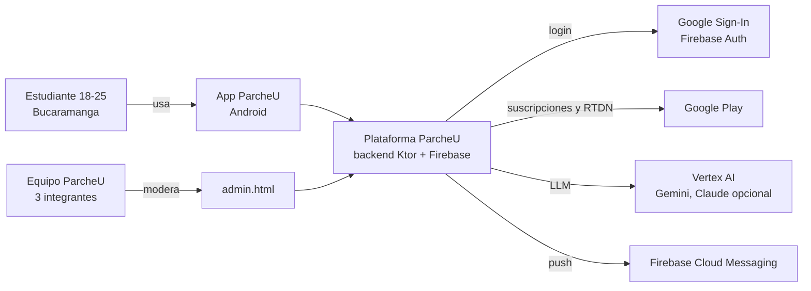
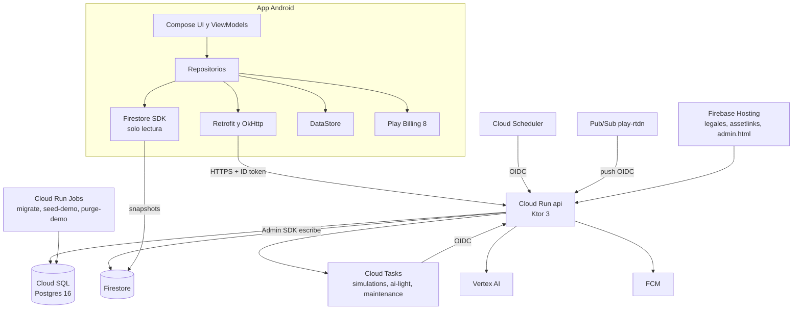
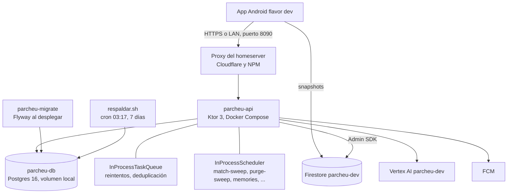
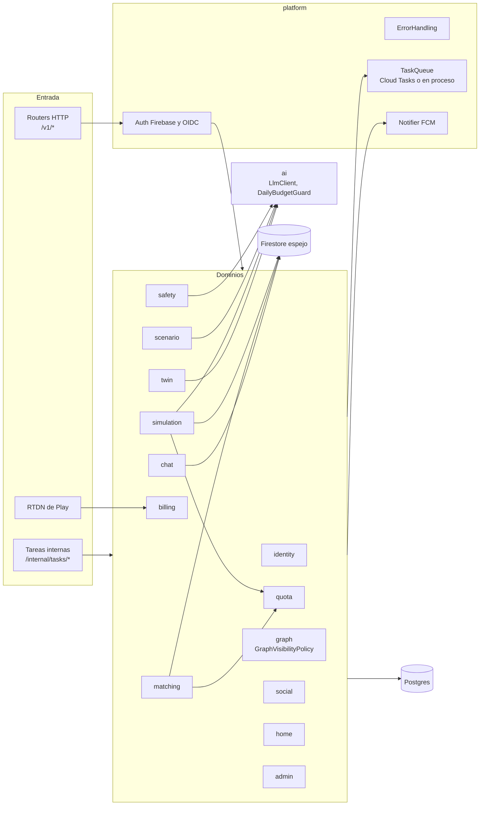
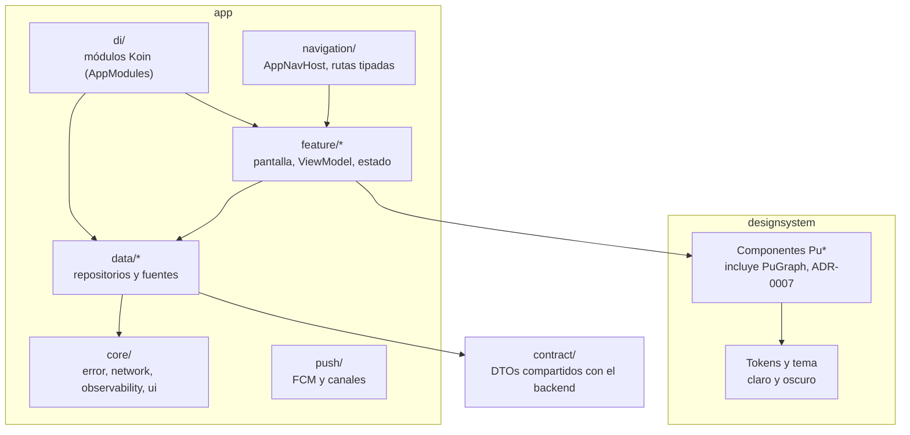
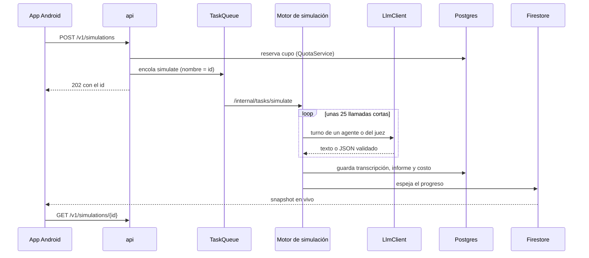

# ParcheU · Modelo C4

Diagramas de contexto, contenedores y componentes de ParcheU (E10.7). Todos son Mermaid y GitHub los
renderiza directamente; `scripts/check-mermaid.sh` los valida en CI (`docs-ci`). El detalle de cada pieza vive en
[arquitectura.md](arquitectura.md) y las decisiones en [docs/adr/](adr/README.md). Si cambias un contenedor,
actualiza aquí y en arquitectura.md §1.

Índice: [1 Contexto](#1-contexto) · [2 Contenedores en GCP](#2-contenedores-objetivo-gcp-prod) ·
[3 Contenedores de dev en el homeserver](#3-contenedores-de-dev-en-el-homeserver) ·
[4 Componentes del backend](#4-componentes-del-backend) · [5 Componentes de Android](#5-componentes-de-android) ·
[6 Flujo de una simulación](#6-flujo-de-una-simulación) · [7 Qué cambia entre entornos](#7-qué-cambia-entre-entornos)

## 1. Contexto

Quién usa el sistema y con qué sistemas externos habla (nivel 1).

Ver [ADR-0008](adr/0008-ia-vertex-proveedores-intercambiables.md) (IA) y [ADR-0013](adr/0013-billing-servidor-rtdn.md) (billing).

## 2. Contenedores (objetivo GCP, prod)

Nivel 2 del destino de producción ([ADR-0002](adr/0002-backend-ktor-un-servicio.md),
[ADR-0003](adr/0003-postgres-fuente-de-verdad.md), [ADR-0004](adr/0004-firestore-canal-solo-lectura.md),
[ADR-0019](adr/0019-cloud-tasks-trabajo-asincrono.md)). Postgres es la única fuente de verdad; Firestore es un
espejo de solo lectura para tiempo real.

## 3. Contenedores de dev en el homeserver

Lo que corre hoy para las pruebas ([ADR-0033](adr/0033-backend-en-homeserver.md), `deploy/homelab/`): el mismo
backend, sin Cloud SQL, Cloud Run, Cloud Tasks ni Cloud Scheduler. Las tareas asíncronas y los jobs periódicos
corren dentro del proceso (`TASKS_MODE=inline`: `InProcessTaskQueue` e `InProcessScheduler`). La IA, la
autenticación, Firestore y FCM siguen siendo los reales de `parcheu-dev`.

## 4. Componentes del backend

Nivel 3 del contenedor `api`. Cada paquete de `backend/src/main/kotlin/me/santiagoreina/parcheu/api/` es un
dominio con su router; `Application.kt` los registra todos y `AppContainer` cablea sus dependencias.

Reglas que atraviesan todo el diagrama:

- **Privacidad:** todo lo que muestra personas a terceros pasa por `GraphVisibilityPolicy` y por filtros en SQL;
  la suite de invariantes por propiedades lo prueba ([ADR-0012](adr/0012-privacidad-pareja.md),
  [ADR-0032](adr/0032-memorias-por-modo.md)).
- **Costo de IA:** cuotas, caché, `ai_usage` y `DailyBudgetGuard` escalonado ([ADR-0010](adr/0010-control-de-costo-ia.md)).
- **Fallos de IA:** la moderación es fail-open y avisa a una persona ([ADR-0026](adr/0026-moderacion-ia-fail-open.md)).

## 5. Componentes de Android

Nivel 3 del contenedor de la app ([ADR-0005](adr/0005-android-koin-datastore-sin-ksp.md),
[ADR-0006](adr/0006-navegacion-y-esqueleto-android.md)). Dos módulos Gradle: `app` y `designsystem`.

## 6. Flujo de una simulación

El camino más largo del sistema (F1 a F8): de pedir un match a ver el resultado, con las tres protecciones de
costo (cuota, presupuesto diario y tasa de la cola).

## 7. Qué cambia entre entornos

| Aspecto | Prod (objetivo) | Dev (hoy, homeserver) |
|---|---|---|
| Base de datos | Cloud SQL Postgres 16 | Postgres 16 en Docker, respaldo local diario |
| API | Cloud Run `api` | Contenedor `parcheu-api` |
| Tareas asíncronas | Cloud Tasks (3 colas) | `InProcessTaskQueue` |
| Jobs periódicos | Cloud Scheduler | `InProcessScheduler` |
| Migraciones | Cloud Run Job `migrate` | `parcheu-migrate` antes de la API |
| Alertas y dashboard | Cloud Monitoring | `docker compose logs` |
| Compras | Verificación en Play y RTDN | `grant-plus` de prueba |

Procedimientos de cada entorno en [operacion.md](operacion.md) y [desarrollo-local.md](desarrollo-local.md).
